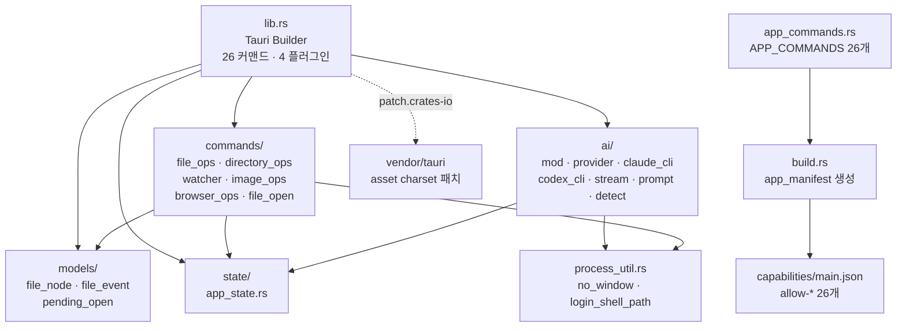
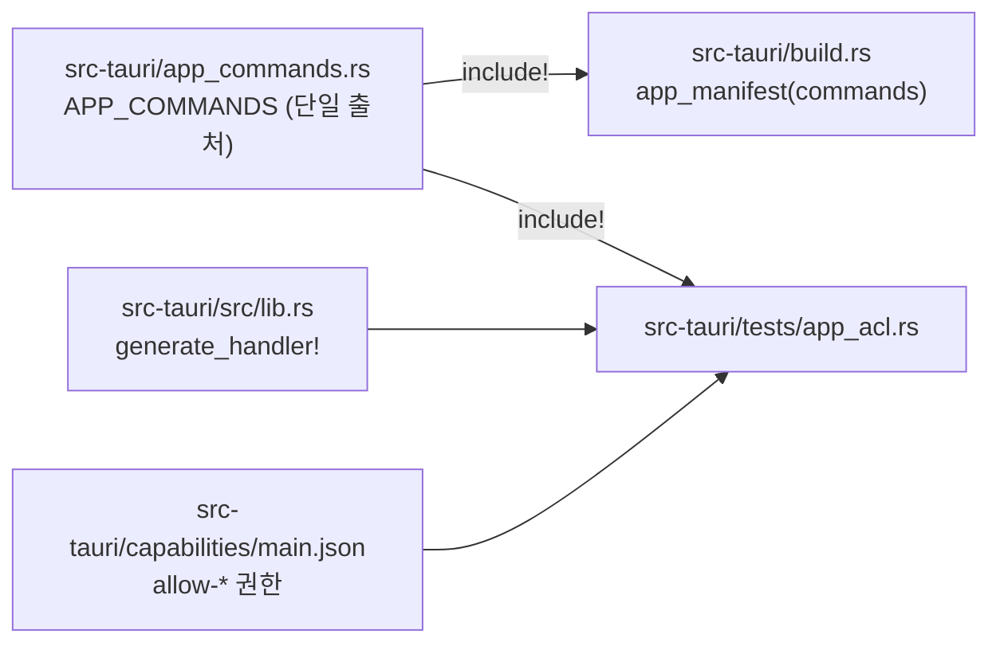

# Backend 아키텍처 - MdEdit v0.21.0

> **Last Updated**: 2026-11-10 | **Version**: 0.21.0
> **Runtime**: Tauri 2 (vendor 사본 2.10.3) + Rust 1.77.2 (edition 2021)

크레이트 이름은 `mdedit`, 라이브러리 이름은 `mdedit_lib`입니다. 실행 파일 진입점 `src-tauri/src/main.rs`는 `mdedit_lib::run()`만 호출하고, 실제 앱 구성은 모두 `src-tauri/src/lib.rs`에 있습니다.

## Rust 모듈 구조

| 모듈 | 책임 |
|------|------|
| `src-tauri/src/lib.rs` | 플러그인 등록, `AppState` 주입, `setup()`, 커맨드 26개 등록, `RunEvent::Opened` 처리 |
| `src-tauri/src/commands/` | 프런트가 호출하는 파일·폴더·감시·이미지·브라우저·외부 열기 커맨드 |
| `src-tauri/src/ai/` | AI CLI(claude, codex) 실행·스트림 중계·정책 스위치 |
| `src-tauri/src/models/` | 직렬화 모델 (`FileNode`, `FileChangedEvent`, `PendingOpenFile`) |
| `src-tauri/src/state/` | `AppState` (감시기, AI 진행 요청, 외부 열기 대기 슬롯) |
| `src-tauri/src/process_util.rs` | 자식 프로세스 공통 규약 (Windows 콘솔 창 숨김, 로그인 셸 PATH) |

## IPC 커맨드 카탈로그 (26개)

`generate_handler!`에 등록된 전체 목록입니다. 실패할 수 있는 커맨드는 모두 `Result<_, String>`을 반환합니다. 프런트에서 보이는 인자 이름은 camelCase입니다.

### 파일 작업 — `src-tauri/src/commands/file_ops.rs`

| 커맨드 | 입력 | 출력 | 비고 |
|--------|------|------|------|
| `read_file` | path | String | UTF-8 읽기, 디렉터리·없는 파일은 오류 |
| `write_file` | path, content | () | 부모 폴더 생성, 임시 파일 후 교체하는 원자적 쓰기 |
| `read_file_size` | path | u64 | 대용량 파일 사전 판정용 |
| `create_file` | path | () | 이미 있으면 오류 |
| `delete_file` | path | () | 디렉터리는 거부 |
| `rename_file` | old_path, new_path | () | 대상이 있으면 오류 |
| `save_file_as` | content, default_path? | Option<String> | 네이티브 저장 대화상자(Markdown 필터) |
| `export_save_dialog` | format, default_name | Option<String> | format은 html, pdf, docx만 허용 |
| `write_binary_file` | path, data(바이트) | () | DOCX 등 바이너리 내보내기 |
| `print_current_window` | (창) | () | 네이티브 인쇄 대화상자 |

`validate_path`는 커맨드가 아닌 공용 보조 함수입니다. 빈 경로와 `..`(상위 폴더) 구성요소를 거부하며, 파일·이미지·폴더 커맨드 대부분이 호출합니다.

### 폴더 작업 — `src-tauri/src/commands/directory_ops.rs`

| 커맨드 | 입력 | 출력 | 비고 |
|--------|------|------|------|
| `read_directory` | path | Vec<FileNode> | 한 단계만 읽는 얕은 목록 |
| `open_directory_dialog` | (앱 핸들) | Option<String> | 폴더 선택 대화상자 |
| `register_asset_scope` | path | () | 정규화(심링크 해소, Windows `\\?\` 제거) 후 asset 프로토콜 scope에 재귀 허용 등록 |

`tauri.conf.json`의 정적 asset scope는 비어 있고, 폴더를 열 때마다 이 커맨드가 런타임에 경로를 추가합니다. 등록은 세션 동안 누적되며 앱을 다시 켜면 초기화됩니다.

### 파일 감시 — `src-tauri/src/commands/watcher.rs`

| 커맨드 | 입력 | 출력 | 비고 |
|--------|------|------|------|
| `start_watch` | path | () | 기존 감시기를 정리한 뒤 `notify` 재귀 감시기 생성 |
| `stop_watch` | — | () | 감시기 해제 |

- 경로별 50ms 디바운스(`DEBOUNCE_MS`)는 감시 콜백 안의 지역 맵으로 처리합니다.
- 무시 대상: 접미사 `.tmp` `.swp` `~`, 경로 조각 `.git/` `.DS_Store` `Thumbs.db` `node_modules/`.
- 경로는 슬래시(`/`)로 정규화해 내보냅니다.

### 이미지 작업 — `src-tauri/src/commands/image_ops.rs`

| 커맨드 | 입력 | 출력 | 비고 |
|--------|------|------|------|
| `save_image_from_clipboard` | md_file_path, image_data_base64 | String(저장 경로) | 마크다운 파일 옆 images 폴더에 저장 |
| `copy_image_to_folder` | source_path, md_file_path | String | 최대 10MB(`MAX_IMAGE_SIZE`) |
| `read_image_as_base64` | image_path | String | 절대 경로 이미지 읽기 |
| `read_relative_image_as_base64` | md_file_path, relative_src | String | 상대 경로 이미지 읽기, `..` 탈출 차단, MIME 표 7종 |
| `open_image_dialog` | (앱 핸들) | Option<String> | png jpg jpeg gif webp svg bmp 필터 |

### 브라우저·외부 열기

| 커맨드 | 파일 | 동작 |
|--------|------|------|
| `open_url_in_browser(url)` | `src-tauri/src/commands/browser_ops.rs` | macOS `open`, Windows `cmd /C start`, 그 외 `xdg-open` (`process_util::no_window` 적용) |
| `take_pending_open_file()` | `src-tauri/src/commands/file_open.rs` | 외부에서 연 `.md` 대기 슬롯을 한 번에 꺼냄. `Result`가 아니라 `Option<PendingOpenFile>` 반환 |

### AI — `src-tauri/src/ai/mod.rs`

| 커맨드 | 입력 | 출력 | 비고 |
|--------|------|------|------|
| `ai_request` | `{ args: {...} }` | () | 결과는 이벤트로 스트리밍. 페이로드는 반드시 `args`로 한 겹 감싸야 하며 단위 테스트가 이를 고정 |
| `ai_cancel` | `{ args: { requestId? } }` | () | 진행 중 요청 취소 |
| `ai_detect_providers` | — | Vec<ProviderStatus> | 설치·로그인 상태 |
| `ai_policy_status` | — | PolicyStatus | 정책으로 AI가 꺼졌는지와 출처 |

## 앱 진입 흐름 (`src-tauri/src/lib.rs`)

**플러그인 등록 순서**

1. `tauri_plugin_single_instance` — 가장 먼저 등록해야 두 번째 프로세스가 창을 만들기 전에 기존 인스턴스로 넘어갑니다. 콜백은 argv의 첫 `.md`를 대기 슬롯에 올리고, 항상 `main` 창을 복원·표시·포커스합니다.
2. `tauri_plugin_opener`
3. `tauri_plugin_shell`
4. `tauri_plugin_dialog`

**`setup()`**

1. 모든 창에 `src-tauri/icons/icon.png`를 `set_icon`으로 밀어 넣어 Windows 작업표시줄 아이콘 캐시를 덮어씁니다.
2. `ai::probe_policy`로 AI 비활성 정책을 한 번 판정해 `AppState`에 저장합니다.
3. 실행 인자(`std::env::args`)의 `.md`를 대기 슬롯에 올립니다. Windows·Linux의 첫 실행 경로입니다. macOS 번들은 Apple Event로 받으므로 이 단계가 비어 있습니다.

**`RunEvent::Opened`** (macOS·iOS 전용 cfg) — 첫 `file://` `.md` URL만 받아 같은 대기 슬롯에 올립니다. cfg를 제거하면 Windows 빌드가 깨집니다(`Opened` 변형이 Apple 전용).

## 이벤트 (백엔드 → 프런트)

| 이벤트 | 발생 위치 | 페이로드 |
|--------|----------|----------|
| `file-changed` | `src-tauri/src/commands/watcher.rs` | `{ kind: Created/Modified/Deleted/Renamed, path, timestamp(ms) }` |
| `open-file` | `src-tauri/src/commands/file_open.rs` | `{ path, dir }` — 깨우기 신호일 뿐이고, 실제 값은 `take_pending_open_file`로 꺼냄 |
| `ai://chunk` | `src-tauri/src/ai/claude_cli.rs`, `src-tauri/src/ai/codex_cli.rs` | `{ requestId, text }` |
| `ai://done` | 위와 동일 | `{ requestId, result, truncated? }` |
| `ai://error` | 위 + `ai_request`/`ai_cancel`/워치독 | `{ requestId, kind, message, cancelledBy? }` — kind는 login, network, parse, timeout, other |

## AppState (`src-tauri/src/state/app_state.rs`)

모든 필드가 `Mutex`로 감싸여 있고 `.manage(AppState::new())`로 주입됩니다.

| 필드 | 용도 |
|------|------|
| `watcher` | 현재 `notify` 감시기 |
| `watch_path` | 감시 중인 경로 |
| `last_write_time` | 경로별 마지막 이벤트 시각. `start_watch`가 초기화만 하고 실제 디바운스는 콜백 지역 맵을 쓰므로 사실상 잔재로 보임 (모든 사용처를 확인하지는 않음) |
| `in_flight` | 진행 중인 AI 요청 하나 (자식 프로세스, 취소 플래그, 종료 선점 플래그) |
| `ai_policy_disabled` / `ai_policy_source` | AI 정책 스위치와 출처(`env` 또는 `policy-file`) |
| `pending_open_file` | 외부에서 열기 요청된 `.md` 한 건. 새 요청이 덮어씀 |

## 모델 (`src-tauri/src/models/`)

| 타입 | 파일 | 내용 |
|------|------|------|
| `FileNode` | `src-tauri/src/models/file_node.rs` | camelCase 직렬화. `name, path, isDirectory, children?, size?, modifiedTime?(Unix 초)` |
| `FileChangedEvent`, `FileChangeKind` | `src-tauri/src/models/file_event.rs` | 종류는 PascalCase 문자열로 직렬화 |
| `PendingOpenFile` | `src-tauri/src/models/pending_open.rs` | `{ path, dir }`, 직렬화 전용 |

## AI 서브시스템 (`src-tauri/src/ai/`)

| 파일 | 책임 |
|------|------|
| `src-tauri/src/ai/mod.rs` | 4개 커맨드, 정책 판정, 워치독, 진행 요청 교체 |
| `src-tauri/src/ai/provider.rs` | `AiProvider` 트레이트, `ProviderRegistry`, `AiModel`(Haiku/Sonnet), `ProviderStatus` |
| `src-tauri/src/ai/claude_cli.rs` | claude CLI 인자 구성·실행·stdout 중계, 기본 레지스트리(claude, codex 순) |
| `src-tauri/src/ai/codex_cli.rs` | codex CLI 인자 구성·실행·JSONL 중계 |
| `src-tauri/src/ai/stream.rs` | 순수 파서 (텍스트 델타, 최종 결과, stderr 분류, codex 메시지) |
| `src-tauri/src/ai/prompt.rs` | 기능별 프롬프트 조립, 문단 경계 자르기 |
| `src-tauri/src/ai/detect.rs` | 바이너리 경로 탐색, 설치·로그인 판정 |

**`ai_request` 처리 순서**

1. 정책 플래그가 켜져 있으면 즉시 오류. 정책은 앱 설정 폴더의 `ai-policy-disabled` 파일이 환경변수 `MDEDIT_AI_DISABLED`보다 우선합니다.
2. 기능 해석: inline-edit, section-fill, diagram 등(Polish, Outline, Table, Diagram, Shorten, Custom, FillSection, Continue).
3. `prompt.rs`가 시스템·사용자 프롬프트를 조립. 앞뒤 문맥은 문단 경계에서 잘라 `truncated`를 표시하고, 선택 텍스트는 자르지 않습니다.
4. 모델 선택: 기본 Haiku, 요청 시 Sonnet.
5. 공급자 라우팅: id를 지정하면 그 공급자, 없으면 설치·로그인된 첫 공급자(claude 우선, codex 대체).
6. 앱 데이터 폴더 아래 `ai-scratch` 빈 폴더를 작업 디렉터리로 사용(격리).
7. 이미 진행 중인 요청이 있으면 취소 플래그를 세우고 종료 선점 후 kill, 옛 id에 `cancelledBy: new-request` 오류 이벤트를 내보냄.
8. 공급자가 자식 프로세스를 띄우고, 중계 스레드가 stdout/stderr를 읽어 이벤트로 변환.
9. 60초 워치독(`WATCHDOG_TIMEOUT_SECS`)이 응답 없는 요청을 timeout 오류로 종료.

**종료 이벤트는 한 번만**: 중계 스레드, 워치독, `ai_cancel`, 교체 경로가 모두 `claim_terminal`(원자적 플래그 선점)로 종료 이벤트 발행권을 먼저 얻은 뒤에만 이벤트를 냅니다.

**공급자별 차이**

- claude: `-p`, `--system-prompt`, `--output-format stream-json`, 빈 `--tools ""`(내장 도구 전부 비활성) 등으로 실행하고 토큰 단위 델타를 `ai://chunk`로 중계합니다. Haiku는 `MAX_THINKING_TOKENS=0`을 지정합니다.
- codex: 시스템 프롬프트 옵션이 없어 두 프롬프트를 하나로 합쳐 `exec ... --sandbox read-only --json`으로 실행합니다. 메시지가 한꺼번에 오므로 `ai://chunk`는 메시지당 한 번 나가고, `turn.completed`에서 `ai://done`을 냅니다. 모델은 두 단계 모두 `gpt-5.5`이며 추론 강도만 medium/high로 다릅니다.
- `src-tauri/src/process_util.rs`: 두 공급자의 spawn·버전 확인과 URL 열기에서 Windows 콘솔 창을 숨깁니다(`no_window`). 로그인 셸 PATH(`login_shell_path`)는 node가 필요한 codex에만 주입합니다.

## 앱 커맨드 ACL (SPEC-SEC-001)

앱 자체 커맨드를 허용 목록으로 묶어, 원격·불투명 출처 프레임이 호출하지 못하게 하는 장치입니다.

- 커맨드를 추가할 때는 세 곳을 함께 고쳐야 합니다: `src-tauri/src/lib.rs`의 `generate_handler!`, `src-tauri/app_commands.rs`의 `APP_COMMANDS`, `src-tauri/capabilities/main.json`의 `allow-<kebab-case>`. 하나라도 어긋나면 빌드는 되지만 실행 시 거부됩니다.
- `src-tauri/tests/app_acl.rs`가 이 세 곳의 일치(26개, 중복 없음)와 `remote` 키 부재, 창 이름 `main` 고정을 검사합니다.
- `src-tauri/capabilities/main.json`에는 `core:default`, `core:window:allow-destroy`, 26개 `allow-*`, 그리고 `opener:default`와 경로 `**`를 허용하는 `opener:allow-open-path`, `opener:allow-reveal-item-in-dir`이 있습니다.
- `src-tauri/build.rs`는 아이콘 파일 변경에도 `rerun-if-changed`를 걸어 Windows exe 아이콘이 낡은 채로 남는 문제를 막습니다.

## tauri.conf.json 요점

- 식별자 `com.mdedit.app`, 창 1280x800, 프런트 `devUrl` `http://localhost:1420`, 빌드 결과 `../dist`.
- `app.security.csp`는 `null`(앱 전체 CSP 없음). HTML 미리보기의 CSP는 srcdoc에 프런트가 직접 주입합니다 ([pipelines.md](./pipelines.md) 참조).
- `assetProtocol`은 켜져 있고 scope는 비어 있음(런타임 등록).
- `.md` 파일 연결(`fileAssociations`)이 설정되어 있고, macOS 서명 신원은 `-`(ad-hoc)입니다.

## vendored tauri 패치 (SPEC-PREVIEW-022)

HTML 원본 보기에서 UTF-8 파일이 한글 깨짐 없이 표시되도록, asset 프로토콜 응답에 charset을 붙이는 수정을 담은 tauri 2.10.3 사본을 `src-tauri/vendor/tauri`에 두고 `src-tauri/Cargo.toml` 끝의 `[patch.crates-io]`로 대체합니다.

- 새 파일 `src-tauri/vendor/tauri/src/protocol/asset/charset.rs`의 `html_content_type(mime, full_body)`: MIME이 `text/html`이고 전체 본문이 유효한 UTF-8일 때만 `text/html; charset=utf-8`을 돌려주고, 그 외(EUC-KR 등)는 원래 MIME을 그대로 둡니다. 전체 본문을 읽지 않은 경우(Range, HEAD)는 판정하지 않습니다.
- `src-tauri/vendor/tauri/src/protocol/asset.rs`의 응답 조립부가 이 함수를 호출해 `Content-Type`을 교체합니다.
- `src-tauri/tests/asset_charset.rs`가 같은 파일을 `#[path]`로 직접 불러 8개 테스트를 실행하고, `Cargo.lock`의 tauri 항목이 2.10.3이며 `source`가 없는지(= 패치 사본이 실제로 쓰이는지)까지 확인합니다. 픽스처는 `src-tauri/tests/fixtures/charset/`에 있습니다.
- `[patch.crates-io]` 블록은 `[profile.release]` 뒤에 둬야 합니다. `src/test/aiDiagramTypeRegressionGuard.test.ts`가 `[dependencies]`부터 `[profile`까지를 크레이트 목록으로 읽기 때문입니다.
- tauri를 올릴 때의 재적용 절차는 `.moai/specs/SPEC-PREVIEW-022-html-original-charset/research.md` 6절에 있습니다.

## 의존 크레이트 (`src-tauri/Cargo.toml`)

| 크레이트 | 버전 | 용도 |
|---------|------|------|
| tauri | 2 (features: protocol-asset, image-png) | 셸, asset 프로토콜 (vendor 사본으로 대체) |
| tauri-plugin-opener / shell / dialog / single-instance | 2 | 외부 열기, 셸, 대화상자, 단일 인스턴스 |
| serde, serde_json | 1 | 직렬화 |
| tokio | 1 (full) | 비동기 커맨드 |
| notify | 6 | 파일 감시 |
| base64 | 0.22 | 이미지 인코딩 |

릴리스 프로파일: `panic = "abort"`, `codegen-units = 1`, `lto = true`, `opt-level = "s"`, `strip = true`.

## Rust 테스트

`src-tauri/src` 안의 `#[cfg(test)]` 단위 테스트가 371개(`#[test]` 313개 + `#[tokio::test]` 58개, grep으로 센 값), `src-tauri/tests`의 통합 테스트가 11개(`app_acl.rs` 3개, `asset_charset.rs` 8개)입니다. 파일별 개수와 실행 방법은 [testing.md](./testing.md)를 참조하세요. 테스트를 직접 실행해 통과를 확인한 것은 아닙니다.

## @MX 태그 요약

| 태그 | 위치 | 의미 |
|------|------|------|
| @MX:ANCHOR | `src-tauri/src/lib.rs` | 모든 커맨드·플러그인 배선의 중심 |
| @MX:ANCHOR | `src-tauri/src/ai/claude_cli.rs` | 빈 `--tools` 인자는 내장 도구 비활성 계약 |
| @MX:WARN | `src-tauri/src/lib.rs` | `RunEvent::Opened` cfg 제거 금지 |
| @MX:WARN | `src-tauri/vendor/tauri/src/protocol/asset.rs` | 상류 패치 지점 |
