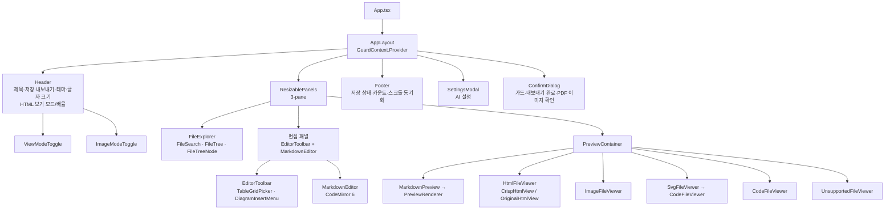

# Frontend 아키텍처 - MdEdit v0.21.0

> **Last Updated**: 2026-11-10 | **Version**: 0.21.0
> **Framework**: React 18.3.1 + TypeScript 5.5 + Zustand 5 + CodeMirror 6 + Tailwind 3.4 (Vite 5.4)

데이터가 흐르는 순서(렌더, 감시, 내보내기, 이미지, AI)는 [pipelines.md](./pipelines.md)에, Rust 쪽 커맨드는 [backend.md](./backend.md)에 있습니다. 이 문서는 UI 계층의 구성 요소와 의존 관계를 다룹니다.

## 진입과 셸

| 파일 | 역할 |
|------|------|
| `index.html` | Vite 셸. `<meta>` CSP를 가집니다 (`default-src 'self' tauri: asset: http(s)://asset.localhost`, `script-src`에 crisp 모드 iframe 스크립트용 sha256 해시, `img-src`에 `data:`, `frame-src`에 asset). `font-src`는 없어서 글꼴은 `default-src`를 따릅니다 |
| `src/main.tsx` | `React.StrictMode`로 `App`을 마운트. `src/index.css`와 `katex/dist/katex.min.css`를 import |
| `src/App.tsx` | 루트. 저장 안 한 변경 가드 1개를 만들어 `AppLayout`과 창 닫기 가드에 전달. 외부에서 `.md`를 열면(`useExternalOpenFile`) 가드를 거쳐 최신 요청만 남기는 체인으로 처리. 마운트 시 대기 중인 외부 열기를 먼저 소비하고, 없으면 `uiStore.lastWatchedPath` 폴더를 복원. 파일 감시 이벤트에서 현재 파일이 바뀌면 깨끗한 상태는 자동 다시 읽기, 수정 중이면 충돌 대화상자 |
| `vite.config.ts` | 별칭 `@` → `src`, 포트 1420(`strictPort`), 개발 서버 `Cache-Control: no-store`, `src-tauri` 폴더 전체를 감시에서 제외. 글꼴 파일은 인라인하지 않음 (`assetsInlineLimit` 함수) |
| `tailwind.config.js` | `darkMode: "class"`, content는 `index.html`과 `src` 아래 js·ts·jsx·tsx 파일 |
| `tsconfig.json` | strict, `noUnusedLocals`, `moduleResolution: bundler`, 별칭 `@/*` |

테마는 두 체계가 함께 동작합니다. Tailwind의 `.dark` 클래스와 `--md-*` 토큰용 `data-theme` 속성이며, `useTheme`이 둘 다 설정합니다.

## 컴포넌트 트리

- `Header`는 `ResizablePanels` 안이 아니라 `AppLayout`이 직접 렌더합니다.
- 보기 전용 파일(html, image, svg, unsupported)에서는 `MarkdownEditor`를 마운트하지 않고 안내 영역만 보여 줍니다 (`isViewOnly`). `.html` 파일에서 보기 모드가 `editor`이면 `ResizablePanels`가 화면에서만 `preview`로 바꿉니다 (스토어 값은 그대로).
- `AppLayout`이 `useTheme`, `useAiRelay`, `useScrollSync`를 호출하고, 시작 시 AI 공급자 감지(`aiDetectProviders`, `aiPolicyStatus`)와 AI 부수 효과 등록(`initAiToggleEffects`, `initAiFileSwitchEffects`)을 수행합니다. 저장·새 문서·내보내기(HTML/PDF/DOCX) 흐름과 서식 버튼 처리도 여기서 연결합니다.

## 컴포넌트 카탈로그

### 레이아웃 — `src/components/layout/`

| 파일 | 책임 |
|------|------|
| `src/components/layout/AppLayout.tsx` | 셸 조립, 저장·내보내기·AI 부팅 연결 (가장 큰 연결 지점) |
| `src/components/layout/Header.tsx` | 파일명과 수정 표시, 새 문서·저장·다른 이름으로 저장, 내보내기 메뉴, 라이트/다크 토글, 글자 크기, 설정 톱니. HTML 파일일 때만 보기 방식 토글(선명/원본)과 배율 −/%/+ 및 단축키(`matchZoomShortcut`) |
| `src/components/layout/Footer.tsx` | 저장 상태, 글자·단어·줄 수, 커서 위치, 스크롤 동기화 토글 |
| `src/components/layout/ResizablePanels.tsx` | 사이드바·에디터·미리보기 3분할과 구분선 드래그. 최소 폭 `MIN_PANE_PX = 240`, `clampPreviewPercent` |
| `src/components/layout/ViewModeToggle.tsx` | `split` / `editor` / `preview` 분할 컨트롤 |

### 사이드바 — `src/components/sidebar/`

| 파일 | 책임 |
|------|------|
| `src/components/sidebar/FileExplorer.tsx` | 폴더 열기·변경, 폴더 단위 지연 로딩(`readDirectory`), 이름 검색 필터. 확장자 허용 목록은 없고 모든 파일을 보여 줌 (SPEC-PREVIEW-007) |
| `src/components/sidebar/FileSearch.tsx` | 검색 입력 |
| `src/components/sidebar/FileTree.tsx` | 루트 노드를 `FileTreeNode`로 매핑 |
| `src/components/sidebar/FileTreeNode.tsx` | 재귀 행. 파일 열기(가드 경유), 펼침·접힘, 자식 지연 로딩, 만들기·이름 바꾸기·삭제 |

### 에디터 — `src/components/editor/`

| 파일 | 책임 |
|------|------|
| `src/components/editor/MarkdownEditor.tsx` | CodeMirror `EditorView`를 한 번 만들고 `editorStore`와 동기화. Ctrl+S 저장, 글자 크기·커서 컴파트먼트 재설정, 이미지 붙여넣기·드롭 처리 |
| `src/components/editor/EditorToolbar.tsx` | 서식 버튼, 표 그리드 선택기(`TableGridPicker`), 다이어그램 삽입 메뉴(`DiagramInsertMenu`) |

### CodeMirror 확장 — `src/components/editor/extensions/`

조립은 `createMarkdownExtensions()`가 합니다. 순서는 마크다운 언어 → 줄 번호·현재 줄·선택 그리기·줄 바꿈 → 구문 강조 → 단축키 → AI 고스트 텍스트(키맵 우선순위가 기본 키맵보다 앞) → 히스토리·기본 키맵·검색·접기 → 긴 줄 자동 접기 → 이미지 위젯 → AI 선택 툴바 → AI 제안 카드 → 기본 테마·커서·글자 크기 컴파트먼트입니다.

| 파일 | 책임 |
|------|------|
| `src/components/editor/extensions/markdown-extensions.ts` | 확장 조립, `cursorCompartment`, `fontSizeCompartment`, 기본 테마 |
| `src/components/editor/extensions/keyboard-shortcuts.ts` | `wrapSelection`, `prefixLine`, `insertTable`, `insertDiagram`, 다이어그램 프리셋 8종(`DIAGRAM_PRESETS`), 키 바인딩 `Mod-b`, `Mod-i`, `Ctrl-/` |
| `src/components/editor/extensions/syntax-highlighting.ts` | 마크다운 구문 강조 스타일 (색이 코드 안 hex 값) |
| `src/components/editor/extensions/image-widget.ts` | `data:` URI 이미지를 썸네일 위젯으로 대체. 보이는 범위(`visibleRanges`)만 스캔 |
| `src/components/editor/extensions/long-line-fold.ts` | 한 줄이 `LINE_FOLD_THRESHOLD`(3 MiB)를 넘으면 자동 접기. 사용자가 펼친 줄은 다시 접지 않음 |
| `src/components/editor/extensions/ai-length-guard.ts` | 선택 길이 한도 판정 (편집형 2000자, 변환형 4000자). 선택을 자르지 않음 |
| `src/components/editor/extensions/ai-selection-toolbar.ts` | 선택 끝의 AI 버튼과 프리셋 메뉴(다이어그램 하위 8항목 포함), 요청 조립 |
| `src/components/editor/extensions/ai-suggestion-card.ts` | AI 제안을 원문 아래 블록 위젯으로 표시. 적용·다시 요청·닫기, 표·다이어그램 검증과 재시도, 오래된 제안 감지 |
| `src/components/editor/extensions/ai-ghost-text.ts` | 섹션 채우기·이어쓰기·자유 위치 이어쓰기의 스트리밍 고스트 텍스트. `Mod-Enter` 확정, `Escape` 취소, 문서가 바뀌면 사라짐 |

### 미리보기 — `src/components/preview/`

| 파일 | 책임 |
|------|------|
| `src/components/preview/PreviewContainer.tsx` | 파일 종류에 따라 뷰어 선택 (아래 라우팅 표) |
| `src/components/preview/MarkdownPreview.tsx` | `usePreview`로 HTML을 받아 `PreviewRenderer`에 전달, 글자 크기를 배율로 환산 |
| `src/components/preview/PreviewRenderer.tsx` | HTML 삽입 후 SVG 마커 복원(`sanitizeSvg` 통과), 다이어그램 컨테이너를 `renderDiagram`으로 그림, 외부 링크 클릭을 가로채 시스템 브라우저로 엶 |
| `src/components/preview/HtmlFileViewer.tsx` | `.html` 보기. 선명 모드와 원본 모드 (아래 설명) |
| `src/components/preview/ImageFileViewer.tsx` | 래스터 이미지를 `convertFileSrc`로 표시 (편집 버퍼에 읽지 않음). 맞춤/사용자 배율, 드래그 이동 |
| `src/components/preview/SvgFileViewer.tsx` | SVG 렌더 보기(`sanitizeSvg`)와 소스 보기(`CodeFileViewer`) 전환. 큰 파일은 소스 보기 대신 안내 |
| `src/components/preview/CodeFileViewer.tsx` | Shiki 읽기 전용 코드 보기 (300ms 디바운스, 테마 연동) |
| `src/components/preview/UnsupportedFileViewer.tsx` | 바이너리·너무 큰 파일 안내 |

### 설정·공용·아이콘

| 파일 | 책임 |
|------|------|
| `src/components/settings/SettingsModal.tsx` | AI 도구 설정 한 구역: 공급자 행(claude, codex), 데이터 전송 안내, AI 사용 토글(정책 잠금 시 비활성), 고급 모델 토글, 이어쓰기 짧게 토글, 연결 안내 마법사. `resolveModel`, `deriveConnectionState` 등을 export |
| `src/components/settings/ImageModeToggle.tsx` | 이미지 삽입 방식 선택(`inline-blob` / `file-save`). `Header`가 렌더 |
| `src/components/common/ConfirmDialog.tsx` | 재사용 모달 (마지막 버튼이 기본 동작, 초기 포커스) |
| `src/components/icons/icons.tsx` | SVG 아이콘 컴포넌트 (서식, 패널, 다이어그램 7종 등) |
| `src/components/icons/diagramIconMarkup.ts` | 다이어그램 아이콘의 SVG 속 마크업. JSX 아이콘과 선택 툴바 하위 메뉴가 공유 |
| `src/components/icons/index.ts` | 아이콘 배럴 |

## 미리보기 라우팅

`getFileViewType(path, previewStatus)`는 `src/lib/preview/fileViewType.ts`에 있고 `PreviewContainer`가 다시 export 합니다. 판정 순서는 다음과 같습니다.

| 순서 | 조건 | 결과 | 뷰어 |
|------|------|------|------|
| 1 | 경로 없음 | markdown | `MarkdownPreview` |
| 2 | `.html` | html | `HtmlFileViewer` |
| 3 | `.md`/`.markdown` + 너무 큼 | unsupported | `UnsupportedFileViewer` |
| 4 | `.md`/`.markdown` | markdown | `MarkdownPreview` |
| 5 | 래스터 이미지 확장자 (png, jpg, jpeg, gif, webp, bmp, ico, avif) | image | `ImageFileViewer` |
| 6 | `.svg` | svg | `SvgFileViewer` |
| 7 | 코드 확장자 (`extensionLangMap`에 있음) | code | `CodeFileViewer` |
| 8 | `previewStatus`가 binary/too-large | unsupported | `UnsupportedFileViewer` |
| 9 | `previewStatus`가 text | text | `CodeFileViewer` (평문) |
| 10 | 그 밖 | markdown | `MarkdownPreview` |

확장자 분기가 `previewStatus`보다 앞에 있습니다. 새 뷰어를 추가할 때는 이 함수의 순서를 지켜야 합니다. `.htm` 확장자는 처리하지 않습니다.

### HtmlFileViewer 보기 모드

- 모드는 `uiStore.htmlRenderMode`(`crisp` / `original` / `null`)입니다. `null`이면 OS 기본값을 따릅니다. `resolveHtmlRenderMode`와 `defaultHtmlRenderMode`가 정하며, Windows는 `original`, 그 밖은 `crisp`입니다.
- **선명 모드(`CrispHtmlView`)**: 파일 크기를 먼저 확인해 `HTML_CRISP_MAX_BYTES`(10 MiB)를 넘으면 원본 모드로 되돌립니다. 그다음 `readFile`로 읽고, `pre.mermaid` / `div.mermaid` 블록을 미리 SVG로 그린 뒤(`prerenderMermaidBlocks`), `buildSrcdoc`으로 `srcdoc`을 만들어 `<iframe sandbox="allow-scripts">`(`allow-same-origin` 없음, 불투명 출처)에 넣습니다. UTF-8이 아니면 읽기 실패로 보고 원본 모드로 되돌립니다. 배율은 `srcdoc`을 다시 만들지 않고 부모가 `postMessage({type: 'mdedit-html-zoom', zoom})`로 보내며, 주입된 스크립트가 `documentElement.style.zoom`을 바꿉니다.
- **원본 모드(`OriginalHtmlView`)**: `convertFileSrc`로 만든 asset URL을 `<iframe sandbox="allow-scripts allow-same-origin">`에 직접 로드합니다. 배율은 CSS `transform: scale`이라 100%를 넘으면 흐려집니다. 한글 깨짐 방지는 Rust의 vendor 패치가 담당합니다 ([backend.md](./backend.md) 참조).
- 배율은 `uiStore.htmlZoom` 하나로 모든 HTML 파일에 적용되고 저장됩니다. 단계는 `HTML_ZOOM_STEPS = [67, 75, 80, 90, 100, 110, 125, 150, 175, 200]`, 기본 100입니다. iframe 안에 포커스가 있으면 단축키가 부모로 오지 않는 한계가 있습니다.

## 훅 — `src/hooks/`

| 훅 | 목적 | 주로 쓰는 것 |
|----|------|--------------|
| `src/hooks/useTheme.ts` | `.dark` 클래스와 `data-theme` 설정, `system`이면 OS 설정을 따름 | `uiStore.theme` |
| `src/hooks/usePreview.ts` | 마크다운 → HTML을 300ms 디바운스로 렌더, 렌더 중에는 이전 HTML 유지, Shiki 한 번 초기화 | `editorStore`, `uiStore.theme`, `renderMarkdown`, `embedPreviewImages` |
| `src/hooks/useScrollSync.ts` | 에디터 맨 위 보이는 줄 ↔ 미리보기 `data-line` 요소 동기화, 되먹임 방지 플래그 | CodeMirror `EditorView` |
| `src/hooks/useFileSystem.ts` | 폴더 열기·변경, 파일 열기(분류해 `previewStatus` 설정), 만들기·삭제·이름 바꾸기, 다른 이름으로 저장. 폴더를 열 때 `registerAssetScope` 호출 | `lib/tauri/ipc`, `saveDocument`, `fileStore`, `editorStore`, `uiStore` |
| `src/hooks/useFileWatcher.ts` | `start_watch` / `stop_watch` 호출과 변경 이벤트 구독 | `@tauri-apps/api` 직접 사용 (`lib/tauri/ipc`를 거치지 않음) |
| `src/hooks/useExternalOpenFile.ts` | 외부에서 연 `.md` 처리: `open-file` 이벤트 수신 + `takePendingOpenFile`, 같은 작업 폴더 판정(`isSameWorkspaceDir`), 최신 요청만 남기는 체인(`createLatestWinsChain`) | `@tauri-apps/api/event`, `lib/tauri/ipc` |
| `src/hooks/useUnsavedChangesGuard.ts` | 저장 안 한 변경 대화상자 상태 기계. `GuardContext`, `useGuard()`. 진행 중 AI 요청을 취소한 뒤 저장 | `editorStore`, `aiStore`, `saveDocument`, `aiCancel` |
| `src/hooks/useWindowCloseGuard.ts` | 창 닫기 요청 가로채기 (수정 중이면 막고 가드에 위임) | `@tauri-apps/api/window`, `editorStore.dirty` |
| `src/hooks/useAiRelay.ts` | `ai://chunk` / `ai://done` / `ai://error` 이벤트를 `aiEventRouter`로 보내고, 현재 `requestId`와 같은 것만 `aiStore`에 반영 | `@tauri-apps/api/event`, `aiStore`, `lib/ai/aiEventRouter` |

## Zustand 스토어 — `src/store/`

| 스토어 | 저장 | 상태와 요점 |
|--------|------|-------------|
| `src/store/editorStore.ts` | 없음 | `content`, `cursorLine`, `cursorCol`, `dirty`, `currentFilePath`. 액션 `setContent`, `setCursor`, `setDirty`, `setCurrentFilePath`, `resetEditor` |
| `src/store/fileStore.ts` | 없음 (`Set`이라 persist 부적합) | `fileTree`, `currentFile`, `expandedDirs: Set`, `watchedPath`, `isLoading`, `previewStatus`(text/binary/too-large/html/null). `updateNodeChildren`으로 지연 로딩 결과를 트리에 반영 |
| `src/store/uiStore.ts` | `persist` 키 `mdedit-ui-store`, version 2 | 사이드바 폭(기본 250), 미리보기 폭(%, 기본 50), 테마(`light`/`dark`/`system`, 기본 system), 글자 크기(기본 14), `htmlZoom`, `htmlRenderMode`, 사이드바 접힘, 스크롤 동기화, `lastWatchedPath`, `imageInsertMode`, `viewMode`, AI 설정(`aiEnabled`, `aiAdvancedModel`, `aiContinueLength`, `aiSelectedProvider`, `aiNoticeAcknowledged`). `saveStatus`와 `statusMessage`는 저장하지 않음. `htmlZoom`은 단계 값으로 맞추고 `htmlRenderMode`는 정규화. 마이그레이션이 v2에서 예전 `htmlRenderMode`를 `original`이 아니면 null로 되돌림 |
| `src/store/aiStore.ts` | 없음 | AI 요청 수명주기: `requestState`(idle/streaming/done/error), `streamBuffer`, `requestId`, `feature`, `errorInfo`, `truncated`, `sessionRequestCount`. 순수 리듀서(`reduceStartRequest` 등)를 따로 export |
| `src/store/aiPolicy.ts` | 모듈 변수 (스토어 아님) | 조직 정책 잠금 캐시. `getEffectiveAiEnabled()` = 정책 허용 && `uiStore.aiEnabled`, `resolveProviderId()`가 `aiRequest`의 공급자 id를 정함. `SettingsModal`과의 순환 import를 피하려고 분리 |

타입 `FileNode`는 `src/types/file.ts`에 있습니다.

## 스타일

| 파일 | 내용 |
|------|------|
| `src/index.css` | import 순서 고정: 글꼴 → 토큰 → 컴포넌트 → Tailwind. 그다음 이미지 위젯, `.dark`, 미리보기 마크다운 스타일, 코드 뷰어, 다이어그램(`.pele-*`), KaTeX |
| `src/styles/mdedit-fonts.css` | `public/fonts/`의 woff2 `@font-face` (Barlow, Barlow Condensed, IBM Plex Mono) |
| `src/styles/mdedit-tokens.css` | `--md-*` 의미 토큰 (라이트는 `:root`와 `[data-theme="light"]`, 다크는 `[data-theme="dark"]`): 색, 글꼴, 간격, 반경, 그림자, 모션 |
| `src/styles/mdedit-components.css` | 토큰만 쓰는 `.md-*` 컴포넌트 클래스 (타이틀바, 버튼, 메뉴, 사이드바 트리, 툴바, 대화상자 등) |

에디터 구문 강조 색(`syntax-highlighting.ts`)과 일부 CodeMirror 거터 색은 토큰이 아니라 코드 안 hex 값입니다.

## 의존 방향

기본 방향은 컴포넌트 → 훅 → 스토어·`lib` → `lib/tauri/ipc`입니다. 스토어는 컴포넌트나 훅을 import하지 않습니다.

다음은 이 방향을 벗어난 곳입니다 (실제 import 기준).

| 위치 | 예외 |
|------|------|
| `src/hooks/useUnsavedChangesGuard.ts` | `ConfirmDialog`의 타입 import (훅 → 컴포넌트, 타입만) |
| `src/components/editor/extensions/ai-ghost-text.ts` | `SettingsModal`의 `resolveModel`을 import (확장 → 설정 컴포넌트). `aiPolicy`를 모듈로 뺀 이유가 이 순환 회피 |
| `src/components/layout/AppLayout.tsx` | `ai-suggestion-card`의 `setAiLoggedIn`, `registerOnboardingOpener`와 `keyboard-shortcuts`의 `wrapSelection`, `insertTable`을 직접 사용 |
| `src/components/layout/ResizablePanels.tsx` | `PreviewContainer`에서 `getFileViewType`을 가져옴 (`Header`는 `lib/preview/fileViewType`에서 가져옴) |
| `src/lib/preview/fileViewType.ts` | `fileStore`의 타입 import (lib → store, 타입만) |
| 컴포넌트 여러 곳 | `lib/tauri/ipc` 함수를 직접 호출 (`AppLayout`, `MarkdownEditor`, `PreviewRenderer`, `HtmlFileViewer`, `SettingsModal`, `FileExplorer`, `FileTreeNode`) |
| `src/hooks/useFileWatcher.ts` 외 3개 | `@tauri-apps/api`를 직접 사용 (`useExternalOpenFile`, `useAiRelay`, `useWindowCloseGuard`) |
| CodeMirror 확장 | 훅 대신 `uiStore`, `aiStore`를 `getState()`로 읽음 |

## IPC 계층 (`src/lib/tauri/ipc.ts`)

타입이 있는 래퍼 26개가 Rust 커맨드 26개와 1:1로 대응합니다 (`src-tauri/src/lib.rs`의 `generate_handler!`와 같은 목록). 파일 맨 위 주석은 "파일 시스템 계층"이라고 하지만 AI, 이미지, 내보내기, asset, 외부 열기 커맨드도 함께 감쌉니다.

| 묶음 | 래퍼 → Rust 커맨드 |
|------|--------------------|
| 파일 | `readFile`→`read_file`, `writeFile`→`write_file`, `readFileSize`→`read_file_size`, `createFile`→`create_file`, `deleteFile`→`delete_file`, `renameFile`→`rename_file`, `saveFileAs`→`save_file_as`, `exportSaveDialog`→`export_save_dialog`, `writeBinaryFile`→`write_binary_file`, `printCurrentWindow`→`print_current_window` |
| 폴더·감시 | `readDirectory`→`read_directory`, `openDirectoryDialog`→`open_directory_dialog`, `registerAssetScope`→`register_asset_scope`, `startWatch`→`start_watch`, `stopWatch`→`stop_watch` |
| 이미지 | `saveImageFromClipboard`→`save_image_from_clipboard`, `copyImageToFolder`→`copy_image_to_folder`, `readImageAsBase64`→`read_image_as_base64`, `readRelativeImageAsBase64`→`read_relative_image_as_base64`, `openImageDialog`→`open_image_dialog` |
| 브라우저·외부 열기 | `openUrlInBrowser`→`open_url_in_browser`, `takePendingOpenFile`→`take_pending_open_file` |
| AI | `aiRequest`→`ai_request` (`{ args }`로 감쌈), `aiCancel`→`ai_cancel` (`{ args: { requestId } }`), `aiDetectProviders`→`ai_detect_providers`, `aiPolicyStatus`→`ai_policy_status` |

- Rust 커맨드 없이 opener 플러그인을 쓰는 래퍼가 둘 있습니다: `openExportedFile`(`openPath`), `revealExportedFile`(`revealItemInDir`).
- `ipcErrorMessage(reason, fallback)`가 invoke 거부 값을 사용자에게 보일 문장으로 바꿉니다.
- 타입: `AiModel`(`haiku`/`sonnet`), `AiRequestArgs`, `AiProviderStatus`, `AiPolicyStatus`, `PendingOpenFile`, `DiagramType`(재export).
- 구독하는 이벤트: `file-changed`(`useFileWatcher`), `open-file`(`useExternalOpenFile`), `ai://chunk` `ai://done` `ai://error`(`useAiRelay`).
- 새 커맨드를 호출하는 `invoke('이름')`을 추가하면 `src/test/appCommandAcl.contract.test.ts`가 `src-tauri/app_commands.rs`에 그 이름이 있는지 검사합니다.
- `src/hooks/useFileWatcher.ts`는 래퍼를 쓰지 않고 `invoke('start_watch' | 'stop_watch')`를 직접 부르며, `src/hooks/useFileSystem.ts`는 래퍼 `startWatch`를 부릅니다.

---

**관련 문서**: 렌더·내보내기·이미지·AI 흐름은 [pipelines.md](./pipelines.md), 테스트 구성은 [testing.md](./testing.md)
