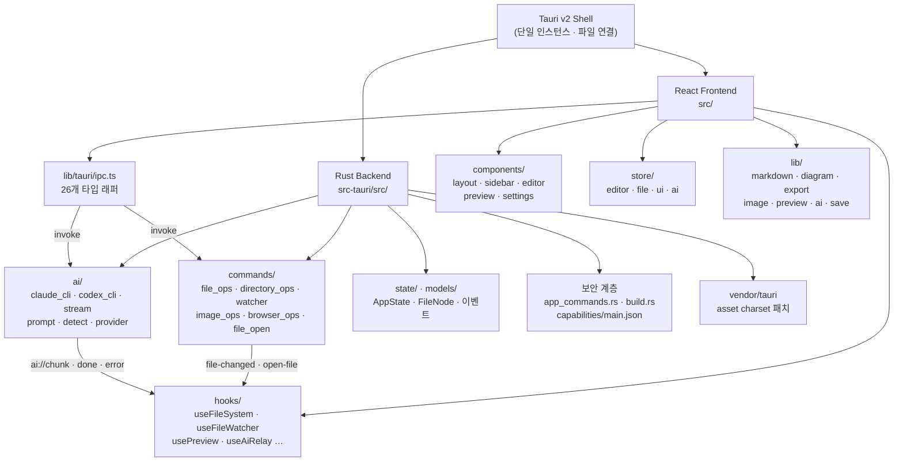

# 아키텍처 개요 - MdEdit v0.21.0

> **Last Updated**: 2026-11-10 | **Version**: 0.21.0
> **Stack**: Tauri v2 (Rust 1.77.2) + React 18.3.1 + TypeScript 5.5 + CodeMirror 6 + Vite 5.4

## 프로젝트 요약

MdEdit는 크로스 플랫폼(macOS·Windows) 데스크톱 마크다운 에디터입니다. Tauri v2(Rust 백엔드)와 React 18(프론트엔드)로 만들었습니다.

**핵심 기능**

- **3-pane 레이아웃**: 사이드바 파일 탐색기, CodeMirror 6 에디터, 실시간 미리보기. 보기 모드는 `split` / `editor` / `preview`.
- **마크다운 렌더링**: markdown-it + Shiki 구문 강조 + KaTeX 수식 + 다이어그램 펜스(```` ```mermaid ````)는 pele 렌더러로 그림. 색은 고정 팔레트 "잉크 앤 허니".
- **여러 파일 형식 보기**: 마크다운 외에 HTML(선명/원본 모드, 배율), 래스터 이미지, SVG, 코드 파일(py, js, ts, json, yaml, toml, sh, css), 그 밖 텍스트를 보여 주고, 바이너리·초대형 파일은 안내만 합니다.
- **내보내기**: HTML(스크립트 없음), PDF(네이티브 인쇄 API), DOCX(`docx` 패키지). HTML·DOCX는 저장 뒤 열기/폴더에서 보기 모달.
- **AI 보조**: 사용자 PC의 claude 또는 codex CLI를 자식 프로세스로 실행. 선택 영역 편집·표·다이어그램 제안 카드, 섹션 채우기·이어쓰기 고스트 텍스트.
- **파일 연동**: 탐색기에서 폴더 열기, 파일 감시(50ms 디바운스), `.md` 파일 연결(더블클릭·단일 인스턴스), 저장 안 한 변경 가드.
- **큰 파일 대응**: 100 MiB 초과는 열지 않고, 3 MiB를 넘는 한 줄은 자동 접기, base64 이미지는 뷰포트 안에서만 위젯으로 그림.
- **상태 관리**: Zustand 5 (`uiStore`만 localStorage `mdedit-ui-store`에 저장).

**버전 이력에서 코드가 바뀐 큰 줄기** (SPEC 번호는 `.moai/specs/` 폴더 이름 기준)

| 영역 | 변화 | 대표 SPEC |
|------|------|-----------|
| 다이어그램 | mermaid 런타임을 pele로 교체, 고정 팔레트, 모양 기반 자동 톤 | SPEC-PREVIEW-015, 016, 017 |
| HTML 미리보기 | 배율, 선명(srcdoc) 모드, OS별 기본 모드, 선명 모드 mermaid 미리 그리기, 원본 모드 charset | SPEC-PREVIEW-018 ~ 022 |
| 보안 | 앱 커맨드 ACL 매니페스트, 글꼴 파일 인라인 금지(CSP) | SPEC-SEC-001, 002 |
| AI | claude/codex 공급자, 제안 카드, 고스트 텍스트, 다이어그램 종류 선택 | SPEC-AI-001 ~ 011 |
| 파일 | `.md` 파일 연결, 저장 안 한 변경 가드, 대용량 파일 안전망 | SPEC-FS-003, 004, SPEC-IMG-LOAD-001, 002 |
| 내보내기 | 이미지 경로 수정, 내보내기 후 열기 모달 | SPEC-EXPORT-002, 004 |
| 릴리스 | 태그 푸시로 맥·Windows 초안 릴리스 자동 생성 | SPEC-INFRA-002 |

## 전체 아키텍처



## 상세 모듈 맵

| 문서 | 내용 |
|------|------|
| [frontend.md](./frontend.md) | 컴포넌트 트리, 훅, 스토어, CodeMirror 확장, 미리보기 라우팅, IPC 래퍼 |
| [backend.md](./backend.md) | Tauri 커맨드 26개, AppState, 이벤트, AI 서브시스템, 커맨드 ACL, vendor 패치 |
| [pipelines.md](./pipelines.md) | 마크다운·다이어그램·HTML 미리보기·파일·내보내기·이미지·AI 데이터 흐름 |
| [testing.md](./testing.md) | Vitest, Playwright, cargo test, 계약 테스트, CI 워크플로 |

## 기술 스택

버전은 `package.json`, `src-tauri/Cargo.toml`의 선언입니다 (`^`는 최소 버전 범위).

### Frontend

| 영역 | 구성 |
|------|------|
| 프레임워크 | React 18.3.1 (`react`, `react-dom` ^18.3.1), TypeScript ^5.5.0 |
| 에디터 | CodeMirror 6 (`@codemirror/view` ^6.39.15, `state`, `commands`, `language`, `lang-markdown`, `autocomplete`, `search`) |
| 마크다운 | markdown-it ^14.1.1, Shiki ^3.22.0, `@traptitech/markdown-it-katex` ^3.6.0, KaTeX ^0.16.44 |
| 다이어그램 | pele 1.10.0 (정확히 고정) |
| 정화 | DOMPurify ^3.4.12 |
| 내보내기 | docx ^9.6.0 |
| 상태 | Zustand ^5.0.0 (persist) |
| 스타일 | Tailwind ^3.4.0 + CSS 변수 토큰 (`src/styles/mdedit-tokens.css`), 글꼴 Barlow·IBM Plex Mono (`public/fonts/`) |
| IPC | `@tauri-apps/api` ^2, `@tauri-apps/plugin-opener` ^2, `@tauri-apps/plugin-shell` ^2.3.5 |

### Backend (`src-tauri/Cargo.toml`)

| 영역 | 구성 |
|------|------|
| 런타임 | Tauri 2 (features `protocol-asset`, `image-png`), `[patch.crates-io]`로 `src-tauri/vendor/tauri`(2.10.3) 사용, Rust 1.77.2, edition 2021 |
| 비동기 | tokio 1 (full) |
| 파일 감시 | notify 6 |
| 직렬화 | serde 1, serde_json 1 |
| 기타 | base64 0.22 |
| 플러그인 | opener, shell, dialog, single-instance (모두 2) |

### Build & DevOps

- **프런트 빌드**: Vite ^5.4.0 (`npm run build-vite`), 개발 서버 포트 1420
- **앱 빌드**: `tauri build` (`npm run build`), Windows에서는 `scripts/prebuild.mjs`가 `cargo clean`을 먼저 실행 (`SKIP_CARGO_CLEAN=1`로 건너뜀)
- **릴리스 프로파일**: `panic = "abort"`, `codegen-units = 1`, `lto = true`, `opt-level = "s"`, `strip = true`
- **테스트**: Vitest ^2.0.0 + jsdom ^28.1.0, Playwright ^1.58.2 (webkit), `cargo test`
- **린트**: ESLint ^8.57.0 (`--max-warnings 0`), `tsc --noEmit`
- **CI**: `.github/workflows/frontend-gates.yml`(PR·main 푸시: lint, typecheck, vitest, Playwright), `.github/workflows/release.yml`(태그 푸시: 버전 검사 → 초안 릴리스 → 맥·Windows 빌드)

## 진입점

| 파일 | 역할 |
|------|------|
| `src/main.tsx` | React 엔트리 (KaTeX CSS import) |
| `src/App.tsx` | 루트: 저장 안 한 변경 가드, 외부 열기, 시작 시 폴더 복원, 파일 감시 반응 |
| `src/components/layout/AppLayout.tsx` | 셸 조립, 저장·내보내기·AI 부팅 연결 |
| `src-tauri/src/main.rs` | `mdedit_lib::run()` 호출만 |
| `src-tauri/src/lib.rs` | Tauri Builder: 플러그인 4개, `AppState`, 커맨드 26개, 외부 열기 훅 |
| `src-tauri/build.rs` | 앱 커맨드 ACL 매니페스트 생성 |
| `scripts/prebuild.mjs` | Windows 빌드 전 `cargo clean` 훅 |
| `scripts/check-release-version.mjs` | 릴리스 태그와 세 설정 파일의 버전 일치 검사 (릴리스 워크플로가 호출) |

## 저장소 구조 (요약)

| 경로 | 내용 |
|------|------|
| `src/components/` | UI (`common`, `editor`(CodeMirror 확장 포함), `icons`, `layout`, `preview`, `settings`, `sidebar`) |
| `src/hooks/` | 상태·IPC를 묶는 훅 9개 |
| `src/lib/` | `ai`, `diagram`, `export`, `image`, `markdown`, `preview`, `save`, `tauri`, `ui` |
| `src/store/` | `editorStore`, `fileStore`, `uiStore`, `aiStore`, `aiPolicy` |
| `src/styles/` | 글꼴, 토큰, 컴포넌트 CSS |
| `src/test/` | Vitest 테스트와 pele 고정 픽스처 |
| `e2e/` | Playwright spec 21개와 Tauri 모킹 픽스처 |
| `src-tauri/src/` | `ai`, `commands`, `models`, `state`, `process_util.rs` |
| `src-tauri/tests/` | ACL·charset 통합 테스트 |
| `src-tauri/vendor/tauri/` | charset 패치가 들어간 tauri 사본 |
| `docs/` | 사용자 문서 (`docs/BUILD.md`, `docs/RELEASE_GUIDE.md`, `docs/USER_GUIDE.md`, `docs/USER_MANUAL.md` 등) |
| `.moai/specs/` | SPEC 문서 (기능 이력의 출처) |

## 보안 경계 요약

- **IPC 허용 목록**: 앱 커맨드 26개는 `src-tauri/app_commands.rs`를 단일 출처로 `build.rs`가 매니페스트를 만들고, `src-tauri/capabilities/main.json`이 `main` 창에만 권한을 줍니다. 세 곳의 일치는 `src-tauri/tests/app_acl.rs`와 `src/test/appCommandAcl.contract.test.ts`가 검사합니다.
- **경로 검증**: Rust `validate_path`가 빈 경로와 `..`을 거부합니다.
- **XSS 방어**: markdown-it `html: false`, SVG는 DOMPurify(`sanitizeSvg`, 다이어그램 전용 인스턴스), 외부 링크 클릭은 가로채 시스템 브라우저로 엶.
- **CSP**: `index.html`의 메타 CSP를 사용 (`tauri.conf.json`의 `csp`는 `null`). `font-src`가 없으므로 글꼴은 파일로만 내보냅니다.
- **iframe 격리**: 선명 모드 `sandbox="allow-scripts"`(불투명 출처), 원본 모드 `sandbox="allow-scripts allow-same-origin"`.
- **AI**: CLI는 앱 데이터 아래 빈 `ai-scratch` 폴더에서 실행, claude는 내장 도구 전부 비활성(`--tools ""`), codex는 `--sandbox read-only`. 환경변수나 정책 파일로 AI 전체를 끌 수 있습니다.

---

**Legend**

- HARD rule: 절대 위반하지 말 것
- @MX:ANCHOR: 고 fan_in 함수 (>=3 호출자)
- @MX:WARN: 위험 영역 (스레드, 복잡도, 전역 상태, 플랫폼 cfg)
