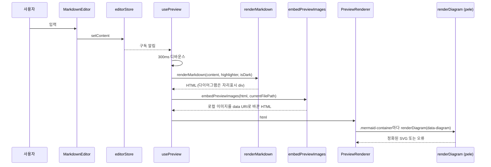
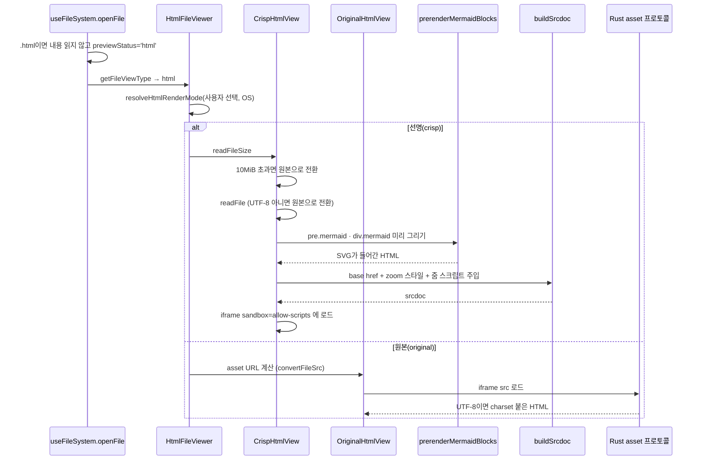
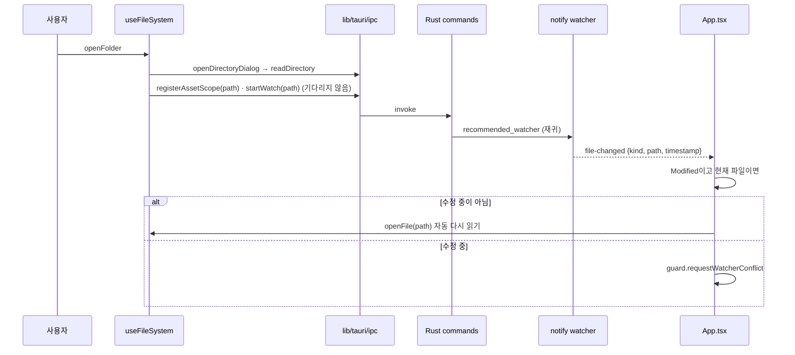
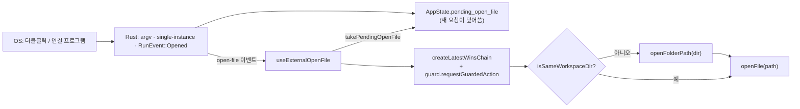
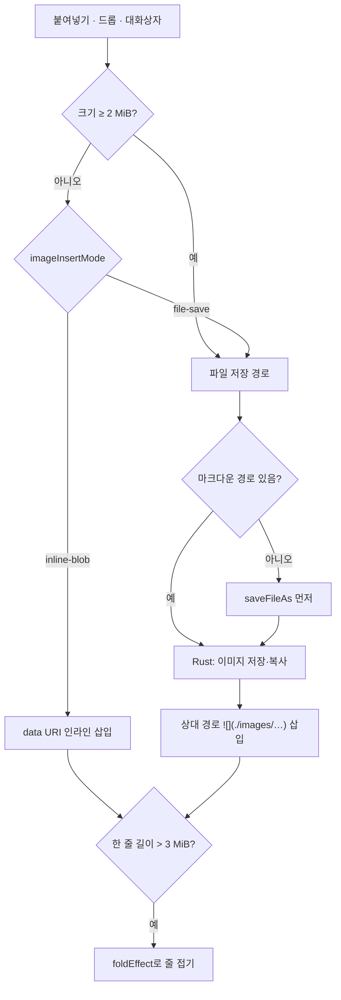
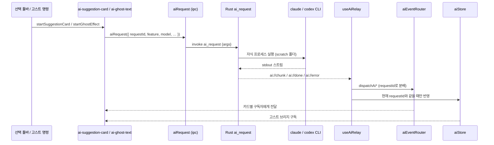
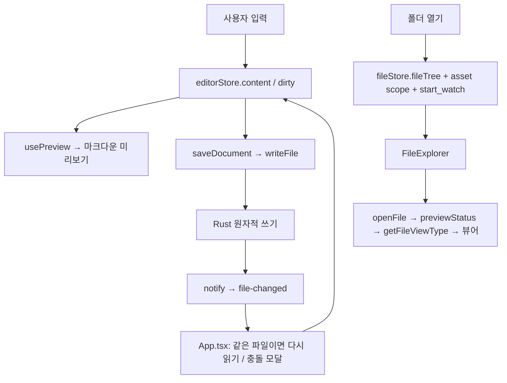

# 데이터 파이프라인 - MdEdit v0.21.0

> **Last Updated**: 2026-11-10 | **Version**: 0.21.0
> **Focus**: 마크다운 렌더링, 다이어그램(pele), HTML 미리보기, 파일 열기·감시·저장, 내보내기, 이미지, AI

각 절은 실제 함수 이름을 따라 코드를 읽어 정리했습니다. 코드가 기준이며 SPEC 문서는 참고만 했습니다.

## 1. 마크다운 렌더링 파이프라인

### 시퀀스



### `renderMarkdown` — `src/lib/markdown/renderer.ts`

시그니처는 `renderMarkdown(content, highlighter | null, isDark = false, mdFilePath?)`이고 export는 이것 하나입니다.

1. `extractInlineSvg`: 코드 블록·인라인 코드 범위를 먼저 구해 보호하고, 그 밖의 `<svg>…</svg>`를 자리표시 토큰으로 바꿉니다. 코드 안의 SVG는 건드리지 않습니다.
2. `new MarkdownIt({ html: false, linkify: true, typographer: true, highlight })`. `html: false`는 XSS 방지를 위해 바꾸면 안 되는 설정입니다. `table`과 `strikethrough`를 켭니다.
3. 코드 하이라이트: `src/lib/markdown/codeHighlight.ts`의 shiki 싱글턴(`github-dark` / `github-light`)을 씁니다. 실패하면 이스케이프한 `<pre><code>`로 되돌립니다.
4. 플러그인 적용 순서:

| 순서 | 플러그인 | 역할 |
|------|---------|------|
| 1 | `mermaidPlugin` (`src/lib/markdown/mermaidPlugin.ts`) | 정보 문자열이 정확히 `mermaid`인 펜스를 `<div class="mermaid-container" data-diagram="…">` 자리표시로 바꿈. 이름은 옛 흔적이고 렌더는 pele가 함 |
| 2 | `markdownItKatex` | `$…$`, `$$…$$` 수식 (`throwOnError: false`) |
| 3 | `tableScrollPlugin` | 표를 스크롤 래퍼로 감싸고 테두리 스타일 지정 |
| 4 | `imageResolverPlugin(mdFilePath)` | 이미지 `src` 재작성과 `max-width: 100%` |
| 5 | `dataLinePlugin` | 블록 요소에 `data-line`(0부터 시작하는 원본 줄 번호) 부여 → 스크롤 동기화용 |
| 6 | `tableCellLineBreakPlugin` | 표 셀 안의 `<br>` 문자열을 줄바꿈 토큰으로 |

5. `restoreSvgMarkers`: 자리표시 토큰을 `<div data-mdedit-svg="인코딩된 SVG">`로 바꿉니다. 실제 삽입 전에 `PreviewRenderer`가 `sanitizeSvg`(`src/lib/preview/svgSanitize.ts`)로 정화합니다.

### 이미지 해석 — `src/lib/image/imageResolver.ts`

미리보기와 내보내기 모두 `embedImagesInHtml`을 통해 로컬 이미지를 data URI로 바꿉니다.

- `readLocalImage(src, mdFilePath, fromHtml)`가 경로 해석의 단일 출처입니다. 후보를 `[디코딩한 값, 원본]` 순서로 시도합니다.
- 절대 경로(`/`로 시작)는 `readImageAsBase64`, `..`을 포함한 상대 경로는 `readRelativeImageAsBase64`, 그 밖은 마크다운 파일 폴더와 합쳐 `readImageAsBase64`로 읽습니다.
- 모두 실패하면 그 이미지는 "임베드 못 함" 목록에 들어가고, 마크다운 파일 경로가 없으면 로컬 파일을 읽지 않습니다.
- `usePreview`는 `renderMarkdown`에 `mdFilePath`를 넘기지 않고, 이미지 처리는 렌더 뒤 `embedPreviewImages`에서 합니다. 그래서 `resolveImageSrc`(asset URL 변환)는 현재 호출 경로로는 쓰이지 않는 것으로 보입니다 (호출처를 읽고 추론한 것이며 실행으로 확인하지는 않음).

### 렌더 오류 처리

- shiki 초기화나 렌더가 실패하면 `usePreview`가 이전 HTML을 유지합니다.
- 다이어그램 문법 오류는 `PreviewRenderer`가 `formatDiagramError`로 만든 한 줄 메시지를 `textContent`로만 넣습니다.

## 2. 다이어그램(pele) 렌더링

다이어그램 렌더 코드는 `src/lib/diagram/diagramRenderer.ts` 한 파일에만 있고, `pele` 패키지(1.10.0 고정)를 이 파일에서만 import 합니다.

```mermaid
graph LR
    A["``` mermaid 펜스"] -->|mermaidPlugin| B["div.mermaid-container<br/>data-diagram"]
    B --> C["PreviewRenderer<br/>renderDiagram"]
    B --> X["내보내기·HTML 선명 모드<br/>renderExportDiagram"]
    AI["AI 카드<br/>validateDiagram"] --> C2["renderDiagram"]
    C --> C2
    X --> C2
    C2 --> P["pele render<br/>PELE_RENDER_OPTIONS + KaTeX math"]
    P --> S["sanitizeDiagramSvg<br/>전용 DOMPurify"]
    S --> OUT["SVG"]
```

- 호출 지점: `PreviewRenderer`(미리보기), `ai-suggestion-card.ts`의 `renderMermaidInto`, `validateDiagram`(검증도 같은 경로), `exportUtils.renderExportDiagram`, `htmlMermaid.ts`.
- 렌더 옵션 `PELE_RENDER_OPTIONS`: `autoDirection: false`, `links: false`, `images: false`, `responsive: true`, 글꼴 Barlow / IBM Plex Mono. 호출마다 `idPrefix`(`pd<번호>`)를 따로 줍니다.
- 수식: KaTeX를 `output: 'mathml'`, `trust: false`로 렌더해 pele의 `math` 해석기로 넘깁니다. 크기는 화면 밖 숨은 요소에서 재며, jsdom에서는 0이라 해석기가 null을 돌려줍니다.
- 정화: 이 파일 전용 DOMPurify 인스턴스(전역 인스턴스와 분리). `data:`, `//`, 문서 밖 스킴의 `href`를 지우고, `foreignObject`는 `class="pele-math"`일 때만 통과시킵니다. 정화 결과가 비면 `{ ok: false, error.code: 'sanitize' }`입니다.
- 팔레트(잉크 앤 허니): `src/styles/mdedit-tokens.css`의 `--pele-*` 변수로 라이트·다크 구분 없이 고정입니다. 배경 `#FAF9F6`, 전경 `#222B33`, 선·강조 `#3A5673`, 오류 `#AC3E31`, 시리즈 색 8개(`#3168A8` … `#96562F`). `--pele-decision-border`(`#8A6410`)는 pele가 읽지 않는 앱 전용 변수입니다.
- 모양 기반 자동 톤(SPEC-PREVIEW-017): 미리보기는 `src/index.css`의 `.pele-shape-diam`(판단 노드: 연한 꿀색 바탕 + 어두운 꿀색 테두리)과 `.pele-shape-stadium`(시작·끝 노드: 잉크블루 테두리) 규칙이 담당합니다. 내보내기는 `exportUtils.ts`의 `SHAPE_TONES`가 노드 `<g>`에 인라인 스타일로 직접 넣으며, 색 변수를 값으로 바꾸는 `resolveDiagramColors`보다 먼저 실행되어야 합니다.
- 종이 카드: 미리보기에서 `.mermaid-container`는 항상 `--pele-bg` 배경이고, 다크 테마에서는 `--pele-border` 테두리와 `--pele-radius` 모서리가 추가됩니다. 내보내기 CSS도 같은 규칙을 리터럴 값으로 가집니다.
- 내보내기용 색 해석: `readPeleThemeValues('light' | 'dark')`가 변수 값을 읽고, `resolveDiagramColors`가 SVG 속성과 `<style>` 텍스트의 `var(--pele-…)`를 값으로 바꿉니다.
- AI 카드 안의 작은 다이어그램에는 문서용 CSS의 모양 톤이 닿지 않습니다.

## 3. HTML 미리보기 (`.html` 파일)



1. **열기**: `useFileSystem.openFile`이 `.html`이면 편집 버퍼를 비워 둔 채 `previewStatus = 'html'`만 설정하고 내용을 읽지 않습니다. 화면은 `getFileViewType`이 `html`로 판정해 `HtmlFileViewer`로 갑니다.
2. **모드 결정**: `resolveHtmlRenderMode(uiStore.htmlRenderMode, detectPlatform())`. 사용자가 고르지 않았으면(null) OS 기본값입니다: 플랫폼 문자열이 `/^win/i`면 `original`, 아니면 `crisp`. 정규식을 `^`로 고정한 이유는 `/win/`이 "Darwin"에도 맞기 때문입니다.
3. **선명 모드**
   - 파일 크기가 `HTML_CRISP_MAX_BYTES`(10 MiB)를 넘거나, 읽기가 실패하거나, UTF-8이 아니면 안내 문구와 함께 원본 모드로 되돌립니다.
   - `prerenderMermaidBlocks`(`src/lib/preview/htmlMermaid.ts`): 주석과 `script`/`style` 같은 원문 요소 안쪽을 공백으로 가려 오프셋을 유지한 채, class에 `mermaid`가 있는 `pre`/`div` 블록을 찾습니다. 이미 `data-processed`이거나 `<svg>`가 있으면 건너뜁니다. 각 블록을 `renderExportDiagram`으로 항상 라이트 값으로 그려 SVG를 넣고(종이 카드 스타일은 허용 문자만 통과), 실패한 블록은 원문을 두고 오류 한 줄을 덧붙입니다. 하나라도 성공하면 Barlow와 IBM Plex Mono용 `@font-face` 스타일을 추가합니다. 어떤 예외든 원본 HTML을 그대로 돌려줍니다.
   - `buildSrcdoc`(`src/lib/preview/htmlSrcdoc.ts`)은 `<head>` 뒤에 `<base href>`, 배율 `<style>`, 줌 프레임 스크립트(`HTML_ZOOM_FRAME_SCRIPT`)를 차례로 주입합니다. `<head>`가 없으면 만들거나 doctype 뒤, 맨 앞 순으로 폴백합니다.
   - iframe은 `sandbox="allow-scripts"`입니다. `allow-same-origin`이 없어 출처가 불투명합니다.
   - CSP: 주입한 스크립트는 `index.html`의 메타 CSP `script-src`에 있는 sha256 해시로 허용됩니다. srcdoc 안에 CSP를 따로 넣지는 않습니다. 해시와 스크립트의 일치는 `src/test/htmlSrcdocCsp.test.ts`가 확인하는 구조입니다 (이 테스트 본문은 열어 보지 않았음).
4. **원본 모드**: `convertFileSrc`로 만든 asset URL(`%2F`, `%5C`는 `/`로 되돌림)을 `sandbox="allow-scripts allow-same-origin"` iframe에 직접 로드합니다. 폴더가 asset scope에 있어야 하므로 폴더를 열 때 `registerAssetScope`가 호출됩니다. 한글 깨짐은 Rust의 vendor 패치가 막습니다 ([backend.md](./backend.md)의 charset 절).
5. **배율**: `HTML_ZOOM_STEPS = [67, 75, 80, 90, 100, 110, 125, 150, 175, 200]`, 기본 100. `snapToStep`은 가장 가까운 단계로, 같은 거리면 작은 쪽으로 맞춥니다. `matchZoomShortcut`은 `=`/`+`(확대), `-`(축소), `0`(초기화)를 처리하고 macOS는 Cmd, 그 밖은 Ctrl만 인정하며 IME 조합 중에는 무시합니다.
   - 선명 모드: 부모가 `postMessage({ type: 'mdedit-html-zoom', zoom: 퍼센트/100 }, '*')`를 보내고, 프레임 스크립트가 `window.parent`에서 온 0.67~2 범위 값만 받아 `documentElement.style.zoom`을 바꿉니다. 같은 스크립트가 `#` 앵커 이동도 직접 처리합니다 (`<base>` 때문에 프레임이 srcdoc을 벗어나기 때문).
   - 원본 모드: 100%가 아닐 때 폭·높이를 `100/배율 %`로 하고 `transform: scale()`을 씁니다. 100%를 넘으면 흐려집니다.
   - 마크다운 미리보기와 코드 뷰어의 배율은 별개로, `getPreviewZoom(fontSize) = fontSize / 14`입니다 (`src/lib/preview/previewZoom.ts`).

## 4. 파일 열기·감시·저장



### 폴더 열기

`useFileSystem.openFolder`는 대화상자 → `readDirectory` → `setWatchedPath` / `setFileTree` / `setLastWatchedPath`를 실행하고, 이어서 `registerAssetScope`와 `startWatch`를 기다리지 않고 호출합니다. 실패해도 폴더 열기는 막지 않고 로그만 남깁니다. `openFolderPath`는 같은 일을 주어진 경로로 하며 실패하면 예외를 던집니다(앱 시작 복원과 외부 열기에서 사용). `changeFolder`에는 저장 안 한 변경 가드가 없습니다.

### 파일 열기 분기 — `useFileSystem.openFile`

`setDirty(false)`로 시작해 첫 번째로 맞는 분기가 적용됩니다. 어느 분기든 `saveStatus`는 `saved`입니다.

| 조건 | 결과 |
|------|------|
| `.html` | `previewStatus = 'html'`, 읽지 않음 |
| 래스터 이미지 확장자 | `previewStatus = 'text'`, 내용 비움, 읽지 않음 |
| `.svg` | 크기 검사 없이 `readFile`. 성공 `text`, 거부 `binary` |
| 크기가 `HARD_CEILING`(100 MB) 초과 | `too-large`, 내용 비움 (크기는 트리의 `size`, 없으면 `readFileSize`, 그것도 실패하면 검사를 건너뜀) |
| `readFile` 성공 | `text` |
| `readFile` 거부 | `binary` |

30 MB~100 MB 구간 파일도 불러와 편집할 수 있고, 긴 줄은 자동 접기가 처리합니다. `SOFT_THRESHOLD`(30 MB)를 읽는 운영 코드는 찾지 못했고 주석에만 있습니다.

### 파일 변경 감시

- Rust 쪽: `start_watch`가 경로당 50ms 디바운스, 무시 패턴, 슬래시 정규화를 거쳐 `file-changed`를 내보냅니다 ([backend.md](./backend.md)).
- `App.tsx`는 `useFileWatcher({ onFileChanged })`로 구독합니다. `kind === 'Modified'`이고 경로가 현재 파일일 때만 반응합니다. 수정 중이 아니면 `openFile`로 자동 다시 읽고(크기 검사 포함), 수정 중이면 `guard.requestWatcherConflict`가 다시 읽기/취소 모달을 띄웁니다. 모달이 열려 있는 동안 오는 감시 이벤트는 버립니다.

### 저장 — `saveDocument({ forceDialog? })` (`src/lib/save/saveDocument.ts`)

1. `saveStatus = 'saving'`.
2. 현재 파일 경로가 있고 `forceDialog`가 아니면 `writeFile`. 아니면 `saveFileAs(content, watchedPath)` 대화상자.
3. 대화상자를 취소하면 `dirty` 상태에 맞게 `unsaved`/`saved`로 되돌리고 `false`를 반환.
4. 성공하면 `currentFilePath`/`currentFile`을 갱신하고 `dirty = false`, `saved`, `true` 반환. 예외면 `unsaved`로 두고 `dirty`를 유지하며 `false` 반환.

### 외부에서 `.md` 열기 (SPEC-FS-004)



- 이벤트 페이로드는 쓰지 않고 깨우기 신호로만 씁니다. 실제 값은 `takePendingOpenFile()`의 원자적 꺼내기로 얻습니다.
- 마운트 시 `App.tsx`가 `consumePendingOpenFile()`을 먼저 호출하고, 소비했다면 `lastWatchedPath` 복원을 건너뜁니다. 라이브 리스너가 먼저 처리한 경우도 `handledRef`로 "소비함"으로 취급합니다.
- 처리는 저장 안 한 변경 가드를 거치며, 진행 중에 들어온 요청은 가장 마지막 하나만 남기는 단일 비행 체인(`createLatestWinsChain`)으로 직렬화합니다.
- `isSameWorkspaceDir`은 `\`를 `/`로 바꾸고 끝 슬래시를 제거하며, 두 경로가 모두 Windows 형태일 때만 소문자로 비교합니다. 같은 작업 폴더면 폴더 열기를 건너뛰고, 다르면 폴더를 먼저 열고(실패하면 중단) 파일을 엽니다.
- Tauri 런타임(`__TAURI_INTERNALS__`)이 없으면 모두 아무 일도 하지 않습니다.

## 5. 내보내기 파이프라인

내보내기 공통: `AppLayout`이 `{ content, filename, theme, highlighter, mdFilePath }`를 만들어 넘깁니다. `theme`은 설정이 `dark`이거나 `system`이면서 OS가 다크일 때 `dark`입니다.

### 5.1 HTML — `exportToHtml` (`src/lib/export/exportHtml.ts`)

1. `generateExportFilename`으로 기본 이름(디렉터리·`.md` 제거, 비면 `document.html`) → `exportSaveDialog('html', …)`, 취소(null)면 종료.
2. `renderMarkdown(content, highlighter)`. 여기서는 `isDark`와 `mdFilePath`를 넘기지 않으므로 코드 블록은 항상 `github-light` 테마입니다. CSS만 `theme`을 따릅니다.
3. `replaceMermaidPlaceholders`: HTML을 `<template>`에 파싱해 `.mermaid-container`마다 `renderExportDiagram(소스, readPeleThemeValues(theme))`의 SVG로 채웁니다. 실패하거나 소스가 비면 컨테이너를 비워 둡니다.
4. `embedAndReport`: `embedImagesInHtml`로 로컬 이미지를 data URI로 바꾸고, 못 넣은 파일 이름은 `onUnembeddedImages`로 알립니다.
5. `getPreviewCss(theme)` + `buildHtmlDocument` → `writeFile(savePath, 문서)` → 저장 경로 반환.
6. 결과에는 JavaScript가 없습니다. 다이어그램은 `var(--pele-…)`가 모두 값으로 풀린 인라인 SVG입니다.

### 5.2 PDF — `exportToPdf` (`src/lib/export/exportPdf.ts`)

1. `generateHtmlContent`(HTML과 같은 파이프라인, 대화상자 없음)로 문서를 만들고 누락 이미지를 모읍니다.
2. 누락이 있고 `confirmUnembeddedImages`가 있으면 확인을 기다립니다. 거절하면 DOM을 건드리지 않고 종료합니다.
3. 문서의 본문과 스타일을 현재 페이지에 `#pdf-export-print`, `#pdf-export-print-style`로 붙이고(`@page { margin: 20mm }`, 나머지 본문은 인쇄에서 숨김), 프레임 두 번을 기다린 뒤 `printCurrentWindow()`를 호출합니다. WKWebView에서는 JS `window.print()`가 동작하지 않기 때문입니다.
4. 정리는 `afterprint` 한 번, 그리고 5분(300000ms) 대비 타이머로 합니다. IPC가 예외를 던지면 즉시 정리하고 다시 던집니다.
5. 완료 모달은 없습니다.

### 5.3 DOCX — `exportToDocx` (`src/lib/export/exportDocx.ts`)

1. 저장 대화상자(취소 시 null).
2. `renderMarkdown`을 쓰지 않고 markdown-it으로 토큰을 직접 파싱합니다.
3. 다이어그램 색은 항상 라이트 값입니다(문서 배경이 흰색). `renderFenceDiagramPng`가 `previewDiagramInput` → `renderExportDiagram` → `svgToPng`(SVG를 data URI로 직렬화해 CSP의 `img-src data:`를 만족시키고 캔버스에 2배로 그려 PNG 변환)를 거치고, 크기는 `DOCX_MAX_IMAGE_WIDTH = 415`pt 이하로 비례 축소합니다. 실패하거나 소스가 비면 코드 텍스트를 넣습니다.
4. 로컬 이미지는 `readLocalImage(…, fromHtml = false)`로 읽고, 못 넣은 이름은 모아서 한 번 알립니다.
5. `Packer.toBlob` → 바이트 배열 → `writeBinaryFile(savePath, bytes)`.

### 5.4 내보내기 이후 (HTML·DOCX만)

저장 경로가 null이 아니면 `AppLayout`이 누락 이미지 목록과 경로를 상태에 넣어 완료 모달을 엽니다. 동작은 `open`(`openExportedFile`), `reveal`(`revealExportedFile`), `cancel`(닫기)이고, 오류는 `window.alert`로 보여 주며 모달은 항상 닫힙니다. 내보내기 자체가 실패해도 `window.alert`로 알립니다.

## 6. 이미지 처리 파이프라인

### 6.1 삽입 경로 선택 — `src/lib/image/imageHandler.ts`



- `resolveImageRoute({ mode, sizeInBytes })`: `IMAGE_INLINE_THRESHOLD`(2 MiB = 2,097,152바이트) 이상이면 모드와 무관하게 `file`, 미만이면 `inline-blob`일 때 `inline`.
- 붙여넣기: `handleImagePaste` → `extractImageFile`(첫 `image/*` 항목) → `preventDefault` → `insertImageFile`. 인라인은 base64 ``, 파일 경로는 `saveImageFromClipboard`가 돌려준 `./images/…` 상대 경로를 삽입합니다. 마크다운 경로가 없으면 `saveFileAs`를 먼저 열고, 취소하면 아무것도 하지 않습니다(인라인으로 대체하지 않음).
- 드롭: `handleImageDrop`이 `posAtCoords`로 위치를 정합니다. 인라인은 경로가 있으면 `readImageAsBase64`, 없으면 파일에서 base64를 만들고, 파일 경로는 `copyImageToFolder` 또는 `saveImageFromClipboard`를 씁니다.
- 대화상자: `insertImageFromDialog` → `openImageDialog` → `readFileSize`로 경로 결정 → 인라인(`readImageAsBase64`) 또는 `copyImageToFolder`.
- 10MB(Rust 쪽 `MAX_IMAGE_SIZE`)를 넘어 실패하면 "이미지가 너무 큽니다(10MB 초과) — 삽입하지 않았습니다" 상태 메시지가 뜹니다.
- 접기: `insertImageMarkdown`이 삽입 뒤 줄 길이를 미리 계산해 `LINE_FOLD_THRESHOLD`(3 MiB = 3,145,728자)를 넘으면 같은 트랜잭션에 `foldEffect`를 넣습니다. 2 MiB 미만 이미지의 base64는 약 2.8M자라 3 MiB 한도 안이므로 인라인 허용 이미지가 접혀 사라지지는 않습니다.

### 6.2 에디터 표시 — `image-widget.ts`

- ViewPlugin이 `docChanged`와 `viewportChanged`에서 다시 계산합니다.
- `buildDecorations`는 `view.visibleRanges`만 줄 단위로 넓혀 합쳐 스캔합니다 (문서 전체 `doc.toString()`을 쓰지 않음, SPEC-IMG-LOAD-002).
- `parseDataUriImage`로 찾은 `data:image/…;base64,…` 이미지를 `Decoration.replace`로 `ImageWidget`(썸네일 최대 높이 80px + 대체 텍스트·MIME·KB)으로 바꿉니다. 원본 텍스트는 바꾸지 않고 `atomicRanges`로 커서가 위젯을 건너뜁니다.

### 6.3 큰 파일과 접기

| 상수 (`src/lib/preview/previewLimits.ts`) | 값 | 용도 |
|------|-----|------|
| `HARD_CEILING` | 100 MiB | 초과하면 `too-large` |
| `SOFT_THRESHOLD` | 30 MiB | 문서 주석상 점진 로딩 기준이나 운영 코드는 읽지 않음 |
| `LINE_FOLD_THRESHOLD` | 3 MiB (자) | 한 줄이 이보다 길면 자동 접기 |
| `IMAGE_INLINE_THRESHOLD` | 2 MiB | 이미지 경로 선택 기준 |
| `STREAM_CHUNK_SIZE` | 256 KiB | 예정된 청크 읽기용, 사용처 없음 |
| `FILE_SIZE_THRESHOLD` | 5 MB | 폐기 예정 별칭, SVG 소스 보기 가드에만 사용 |

`long-line-fold.ts`는 줄 길이가 한도를 넘는(`>`) 줄을 접고, 사용자가 펼친 줄은 `considered` 집합에 남겨 다시 접지 않습니다. 접기 UI는 `markdown-extensions.ts`가 설치하는 `codeFolding()`과 `foldGutter()`가 제공합니다.

### 6.4 파일 종류 판별 보조

`getFileViewType`의 판정 순서는 [frontend.md](./frontend.md)의 라우팅 표를 참조하세요. 관련 모듈은 `src/lib/preview/extensionLangMap.ts`(`py`, `js`/`mjs`/`cjs`, `ts`, `json`/`jsonl`, `yaml`/`yml`, `toml`, `sh`/`bash`, `css`만 코드 뷰어로 보냄), `src/lib/preview/mediaExtensions.ts`, `src/lib/preview/fileTreeUtils.ts`(`findFileNodeSize`)입니다. shiki가 불러오는 언어 목록에는 `xml`, `html`, `rust`, `go`, `markdown`도 있지만 이 매핑에는 없습니다.

## 7. AI 파이프라인

### 7.1 전체 흐름



- `aiStore`는 진행 중인 요청 슬롯이 하나뿐이고 카드는 여러 개일 수 있어서, `useAiRelay`가 모든 이벤트를 먼저 `aiEventRouter`로 보낸 뒤 `requestId`가 현재 슬롯과 같을 때만 스토어에 반영합니다.
- 요청 조립(`buildSelectionRequest`): `feature`는 다이어그램 프리셋이면 `diagram`, 아니면 `inline-edit`. `customInstruction`은 `custom`일 때만, `diagramType`은 `diagram`일 때만, `providerId`는 `resolveProviderId()`(`auto`면 미지정)입니다. 모델은 `aiAdvancedModel`이 켜져 있으면 `sonnet`, 아니면 `haiku`.
- 고스트 요청 id 접두사: `sf-`(섹션 채우기), `cw-`(이어쓰기), `gr-`(고스트 다시 요청), `ai-`(카드 다시 요청). 이어쓰기는 `presetKind: 'continue'`와 `uiStore.aiContinueLength`를 더합니다.

### 7.2 선택 길이 가드 — `ai-length-guard.ts`

| 선택 길이 | 편집형 (polish, custom) | 변환형 (outline, table, diagram, shorten) |
|-----------|------------------------|-------------------------------------------|
| 2000자 이하 | 허용 | 허용 |
| 2001~4000자 | 차단 | 허용하되 `insertOnly` (아래에 삽입만) |
| 4000자 초과 | 차단 | 차단 |

선택 텍스트는 절대 자르지 않습니다. 잘린 입력의 결과로 선택을 바꾸면 읽지 않은 부분이 조용히 사라지기 때문입니다.

### 7.3 제안 카드 상태 기계 — `ai-suggestion-card.ts`

- `reduceCard`의 단계: `streaming` → `done` / `empty` / `error` / `stale` / `retry-exhausted` / `diagram-valid` / `diagram-fallback` / `intruded`. 결과가 비었거나 원문과 같으면 `empty`.
- 다시 요청 종류: `blind`(카운트 +1), `directed`(입력이 있는 재요청, 카운트 0으로 초기화), `exempt`(오류 재시도·자동 검증 재시도, 카운트 변화 없음). `MAX_RETRY = 3`에 닿으면 `retry-exhausted`이고 이후 `blind` 재요청은 무시합니다.
- 완료 시 검증:
  - 다이어그램: `stripMermaidFence` → `validateMermaid`(= `validateDiagram` → `renderDiagram`이라 미리보기와 같은 파이프라인). 첫 실패는 "이전 오류" 문구를 붙여 자동 재요청(`exempt`), 두 번째 실패는 `diagram-fallback`으로 목록(`outline`) 요청을 제안합니다.
  - 표: `validateMarkdownTable`(`src/lib/ai/tableValidate.ts`, 머리글 칸 수와 본문 행 칸 수를 원본 줄 기준으로 비교). 시도는 최대 2번(`TABLE_MAX_VALIDATION_ATTEMPTS`)이고 2번째에는 잘못된 표도 그대로 통과시켜 루프를 끊습니다.
- 적용: `applySuggestion`이 범위의 현재 텍스트와 `originalText`를 비교해 다르면 `stale`로 두고 문서를 바꾸지 않습니다. `replace`는 범위 교체, `insert-below`는 `findBlockEnd` 뒤에 `\n\n`과 함께 삽입하며 다이어그램은 `ensureMermaidFence`로 펜스를 씌웁니다. `insertOnly`면 `insert-below`만 제공합니다. 기본 동작은 표·다이어그램이 `insert-below`, 나머지가 `replace`입니다.
- 취소·정리: 카드 취소는 `aiCancel` + 스토어 취소 + 컨트롤러 제거. `runAiArtifactCleanup`(`src/lib/ai/aiOffEffects.ts`)은 진행 중 스트림 취소, 고스트 지우기, 카드 레지스트리 비우기를 하며 문서 텍스트는 건드리지 않습니다. 실행 시점은 `uiStore.aiEnabled`가 true→false로 바뀔 때(`initAiToggleEffects`)와 현재 파일이 바뀔 때(`initAiFileSwitchEffects`, `src/lib/ai/aiFileSwitchEffects.ts`)입니다.

### 7.4 고스트 텍스트 — `ai-ghost-text.ts`

- 섹션 채우기·이어쓰기·자유 위치 이어쓰기를 `Mod-Enter`로 시작합니다 (먼저 `confirmGhostCommand`, 꺼져 있으면 중단, 없으면 세 시작 명령을 순서대로).
- `ghostStoreBridge`가 `aiStore`를 구독해 `section-fill` 기능의 스트림만 고스트로 반영하고 `idle`/`error`면 지웁니다. 스트리밍 중에는 `■ 중지`, 완료되면 `✓ 넣기` / `✕ 지우기` / `↻`가 보입니다.
- 사용자가 문서를 직접 고쳐 고스트가 사라지면 진행 중 요청을 취소합니다 (`ghostTypingCancelListener`). 3초(`HINT_IDLE_DELAY_MS`) 가만히 있으면 힌트가 나타납니다.

### 7.5 대기 시간 3단계 — `src/lib/ai/waitNotice.ts`

| 시각 | 동작 |
|------|------|
| 8초 | "아직 생성 중이에요 — 취소할 수 있어요" 안내만 표시 |
| 60초 | Rust 워치독이 `ai://error` (`kind: timeout`) 발행 |
| 65초 | 프런트 보험 타이머가 카드를 `error`로 전환 (`FRONTEND_BACKSTOP_DELAY_MS` = 60초 + 5초, 백엔드 오류보다 먼저 터지지 않도록 파생값) |

### 7.6 정책과 공급자

`getEffectiveAiEnabled()`(= 조직 정책이 허용 && `uiStore.aiEnabled`)가 AI 표면 전체의 단일 게이트입니다. 정책 잠금은 Rust의 `probe_policy`가 앱 시작 때 한 번 판정하고, 프런트는 부팅 시 `aiPolicyStatus`로 읽어 `src/store/aiPolicy.ts`에 캐시합니다. 공급자 선택은 `uiStore.aiSelectedProvider`(`auto`/`claude`/`codex`)이며, Rust 쪽 CLI 실행·스트림 중계는 [backend.md](./backend.md)의 AI 절을 참조하세요.

## 8. 상태 흐름 요약


