# 릴리스 자동화 설명서

> 대상 독자: GitHub Actions로 릴리스를 처음 자동화하는 이 저장소의 주인
> 다루는 범위: SPEC-INFRA-002로 추가한 태그 푸시 릴리스 자동화의 구성, 이유, 흐름, 병합 뒤 할 일
> 함께 볼 문서: [docs/BUILD.md의 "GitHub Releases로 배포하기"](BUILD.md#github-releases로-배포하기) (실제 명령의 기준 문서)

이 문서는 "설정 몇 개만 켜면 될 줄 알았는데 왜 파일이 여덟 개나 바뀌었는가"에 답하려고 썼습니다. 무엇을 만들었는지, 왜 필요했는지, 릴리스가 어떤 순서로 흘러가는지, 그리고 병합 뒤 주인이 직접 해야 할 일을 차례로 설명합니다.

아직 실제 GitHub 서버에서 한 번도 돌려 보지 않았다는 점을 먼저 밝혀 둡니다. 이 문서의 동작 설명은 설정 파일과 스크립트, 로컬 검사, 독립 감사 결과를 근거로 합니다. 실제로 확인하지 못한 부분은 본문에 "아직 확인 전"으로 표시했고, 12절에 따로 모았습니다.

## 목차

0. [한눈에 보기](#0-한눈에-보기)
1. [GitHub 설정만 하면 되는 줄 알았는데 왜 작업이 많았나](#1-github-설정만-하면-되는-줄-알았는데-왜-작업이-많았나)
2. [전체 흐름](#2-전체-흐름)
3. [우리가 한 작업 목록](#3-우리가-한-작업-목록)
4. [한 번의 릴리스가 진행되는 모습](#4-한-번의-릴리스가-진행되는-모습)
5. [릴리스의 상태 변화](#5-릴리스의-상태-변화)
6. [안전장치 지도](#6-안전장치-지도)
7. [사용자 화면에서 벌어지는 일](#7-사용자-화면에서-벌어지는-일)
8. [GitHub 화면에서 할 일과 코드로 이미 된 것](#8-github-화면에서-할-일과-코드로-이미-된-것)
9. [앞으로 할 일 (병합 뒤)](#9-앞으로-할-일-병합-뒤)
10. [문제가 생겼을 때](#10-문제가-생겼을-때)
11. [용어 풀이](#11-용어-풀이)
12. [아직 확인하지 못한 것](#12-아직-확인하지-못한-것)
13. [더 읽을 곳](#13-더-읽을-곳)

---

## 0. 한눈에 보기

- 버전 태그(tag, 특정 커밋에 붙이는 이름표) `v0.19.0`을 GitHub에 올리면, GitHub 서버가 맥용·윈도용 설치 파일을 만들어 **초안** 릴리스에 붙입니다.
- 서버는 빌드하기 전에 태그와 앱 버전이 같은지 먼저 확인합니다. 다르면 그 자리에서 멈추고 아무것도 만들지 않습니다.
- 서버는 릴리스를 **게시하지 않습니다**. 주인이 초안을 열어 파일과 본문을 확인한 뒤 직접 게시합니다.
- 앱은 Apple 공증이나 Windows 코드 서명을 받지 않았습니다. 그래서 사용자가 처음 실행할 때 경고가 한 번 나오고, 그 대처법은 README에 적어 두었습니다.

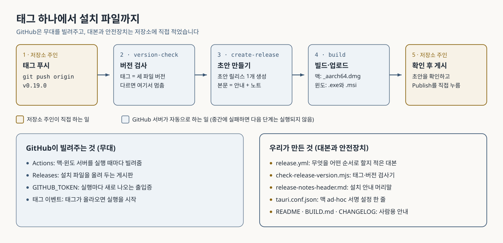

*그림 1. 태그 하나에서 설치 파일까지. 위쪽은 진행 순서, 아래쪽은 GitHub과 저장소의 역할 분담입니다.*

## 1. GitHub 설정만 하면 되는 줄 알았는데 왜 작업이 많았나

GitHub Actions(GitHub이 제공하는 자동 실행 서비스)는 **무대와 장비**를 빌려주는 곳에 가깝습니다. 공연을 하려면 무대만으로는 부족하고, 어떤 순서로 무엇을 할지 적은 대본이 따로 있어야 합니다.

GitHub은 서버(맥·윈도·리눅스), 설치 파일을 올려 두는 Releases 페이지, 실행마다 새로 발급되는 출입증(`GITHUB_TOKEN`)을 줍니다. 하지만 이 저장소가 Tauri 앱이라는 사실도, 맥과 윈도에서 각각 어떻게 빌드해야 하는지도, 태그와 버전이 다를 때 멈춰야 한다는 규칙도 모릅니다. 이런 내용을 알려 주는 대본과 안전장치를 저장소 안에 직접 적어야 했습니다.

| GitHub이 해 주는 것 | 우리가 해야 했던 것 |
|---|---|
| 태그가 올라오면 워크플로를 실행할 수 있는 기능 | 어떤 태그에 반응할지 정하기 (`v숫자.숫자.숫자`만) |
| 맥·윈도 서버(러너)를 실행 때마다 빌려줌 | 어느 서버에서 무엇을 빌드할지 정하기 (Apple Silicon 맥, 64비트 윈도) |
| 실행마다 새 `GITHUB_TOKEN` 발급 | 토큰에 줄 권한을 최소로 줄이고, 필요한 단계에만 넘기기 |
| Releases 페이지와 릴리스 API | 초안으로만 만들고, 게시는 사람이 하도록 설계하기 |
| 자동 릴리스 노트 생성 기능 | 노트의 시작점(직전 버전 태그)을 직접 계산해 넘기기 |
| 다른 사람이 만든 액션을 가져다 쓰는 기능 | Tauri 빌드 액션을 골라 바뀌지 않도록 커밋 단위로 고정하기 |
| (해당 없음) | 태그·버전 일치 검사 스크립트와 그 테스트 작성 |
| (해당 없음) | 맥 ad-hoc 서명 설정, 설치 안내 문구, README·BUILD.md·CHANGELOG 정리 |

정리하면 저장소 설정 화면에서 바꾼 값은 하나도 없습니다. 모든 작업은 저장소 안의 파일로 이루어졌고, 그래서 코드 리뷰와 테스트로 확인할 수 있습니다.

## 2. 전체 흐름

아래 그림은 태그가 올라온 뒤 서버가 실행하는 세 묶음의 작업(job, 워크플로 안에서 한 서버가 맡는 작업 단위)과, 각 지점에서 실패했을 때 어디서 멈추는지를 보여 줍니다. 실선은 정상 흐름, 점선은 한쪽만 실패한 경우입니다.

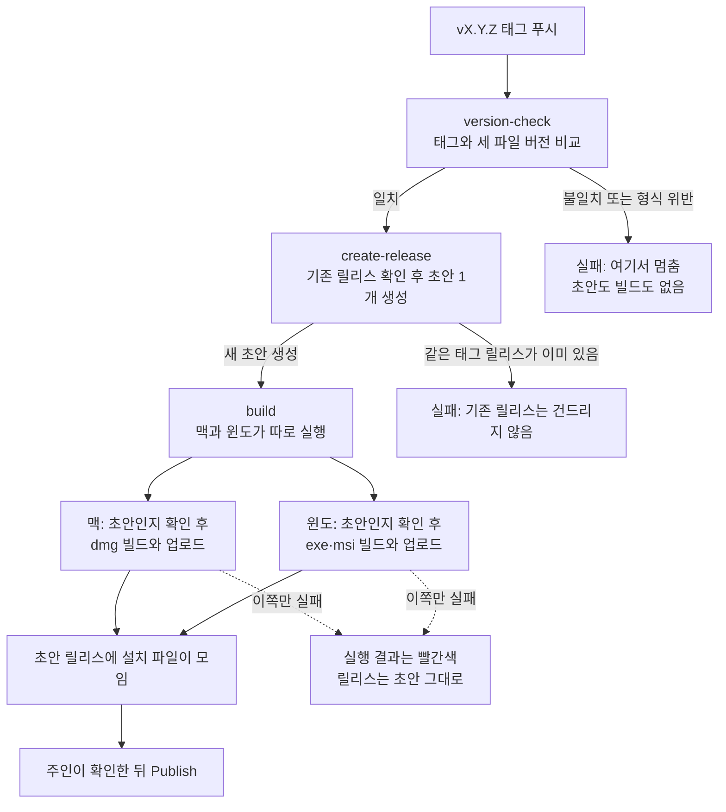

핵심은 세 가지입니다. 버전이 틀리면 첫 단계에서 끝납니다. 같은 태그의 릴리스가 이미 있으면 새로 만들지 않습니다. 맥과 윈도 중 한쪽이 실패해도 다른 쪽은 끝까지 빌드하고, 릴리스는 초안으로 남아 있어 주인이 게시 전에 알아챌 수 있습니다.

## 3. 우리가 한 작업 목록

바뀐 파일은 모두 여덟 개입니다. 새로 만든 파일이 네 개(`release.yml`, `release-notes-header.md`, 검사 스크립트와 그 테스트), 고친 파일이 네 개(`tauri.conf.json`, `README.md`, `docs/BUILD.md`, `CHANGELOG.md`)입니다. 그림 2는 이 파일들이 서로 어떻게 이어지는지 보여 줍니다.

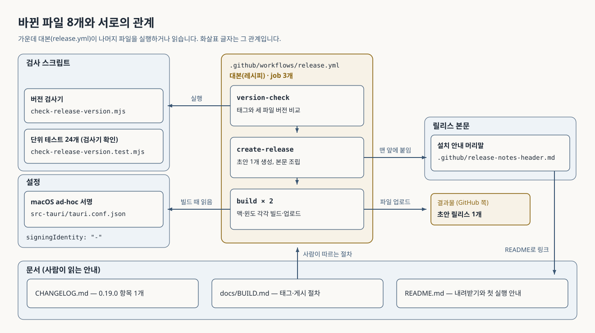

*그림 2. 바뀐 파일 8개와 서로의 관계. 가운데 대본이 나머지를 실행하거나 읽습니다.*

| 작업 | 왜 필요했나 | 어디에 있나 | 어떻게 확인했나 |
|---|---|---|---|
| 1. 워크플로 대본 | 태그가 올라오면 무엇을 어떤 순서로 할지 서버에 알려 줘야 합니다. `v숫자.숫자.숫자` 태그에만 반응하고, job 세 개를 차례로 실행하며, 빌드는 맥(Apple Silicon)과 윈도(64비트) 두 대에서 따로 돌립니다. 같은 태그 실행이 겹치면 진행 중인 실행을 취소하지 않고(`cancel-in-progress: false`) 끝까지 둡니다. job마다 실행 상한(`timeout-minutes`)을 두어 멈춘 작업이 끝없이 돌지 않게 했습니다. | `.github/workflows/release.yml` | `actionlint`(워크플로 문법 검사기) 종료 코드 0. 정적 검사 수용 기준 AC-003·006·008 통과 |
| 2. 태그·버전 검사 스크립트 | 앱 버전은 세 파일에 따로 적혀 있습니다. 태그만 올리고 버전을 안 바꾸면 "0.19.0" 릴리스에 "0.18.0" 앱이 들어가는 사고가 납니다. 빌드 전에 세 값이 태그와 같은지 보고, 다르면 파일별 경로와 값을 로그에 남기고 실패합니다. 직전 버전 태그도 여기서 계산합니다. | `scripts/check-release-version.mjs`, 테스트 `scripts/check-release-version.test.mjs` | 단위 테스트 24개 통과(이 문서를 쓰며 다시 실행). 문장 커버리지 94.82%(독립 감사가 테스트 23개 시점에 측정) |
| 3. "초안만" 설계 | 서버가 스스로 게시하면 확인하지 않은 파일이 바로 사용자에게 나갑니다. 릴리스를 만드는 호출에 `draft=true`를 넣었고, 게시하는 단계는 아예 두지 않았습니다. 빌드를 시작하기 전에는 대상이 아직 초안인지 한 번 더 확인합니다. Tauri 빌드 액션의 `releaseDraft` 입력은 쓰지 않았습니다. 릴리스 번호(`releaseId`)를 넘기면 이 액션은 그 입력을 보지 않기 때문입니다. | `release.yml`의 `Create draft release`, `Ensure target release is still a draft` 단계 | 독립 감사가 `draft=true`를 지운 복사본으로 검사가 실패하는지 확인(변이 시험). 액션 소스에서 `releaseDraft`가 쓰이지 않는 경로임을 확인 |
| 4. 최소 권한과 토큰 관리 | 출입증에 쓰기 권한이 있으면 저장소 내용을 바꿀 수 있습니다. 워크플로 기본값을 읽기 전용으로 두고, 쓰기 권한은 초안 생성과 빌드 job에만 줬습니다. 소스를 내려받을 때 출입증을 디스크에 남기지 않도록 `persist-credentials: false`를 썼고, 토큰은 실제로 필요한 단계에만 넘깁니다(`npm ci` 같은 단계에는 없음). | `release.yml`의 `permissions`, 각 단계의 `env` | 수용 기준 AC-008 통과. 독립 감사가 `npm ci`에 토큰을 넣은 복사본에서 검사가 실패하는지 확인 |
| 5. 외부 액션 커밋 고정 | 남이 만든 액션은 같은 이름의 태그가 나중에 다른 코드를 가리키도록 바뀔 수 있습니다. Tauri 빌드 액션을 커밋 `1deb371b0cd8bd54025b384f1cd735e725c4060f`(v1.0.0)로 고정했습니다. 이 액션의 `v1.0.0` 태그는 "주석 태그"라서 태그 자체의 해시(`2d793bf…`)와 실제 커밋 해시가 다릅니다. 태그 해시를 쓰면 커밋을 가리키지 않으므로 반드시 커밋 해시를 써야 했습니다. | `release.yml`의 `uses: tauri-apps/tauri-action@1deb371…` | 수용 기준 AC-009 통과. 독립 감사가 태그 → 태그 객체 → 커밋 순서로 해시를 따라가 확인 |
| 6. 맥 ad-hoc 서명 | 서명이 전혀 없는 앱을 브라우저로 받으면 맥이 "손상됨"으로 막을 수 있습니다. 인증서 없이 할 수 있는 ad-hoc 서명을 넣어, Apple의 공식 경로("그래도 열기")로 열 수 있게 하려는 설정입니다. BUILD.md에는 로컬 맥 빌드(`npm run build`)도 같은 서명을 받는다고 적었지만 실제 로컬 빌드로는 아직 확인 전입니다. | `src-tauri/tauri.conf.json`의 `bundle.macOS.signingIdentity: "-"` | 설정 값은 수용 기준 AC-007로 확인. 실제 서명 결과는 아직 확인 전 |
| 7. 릴리스 본문 | 사용자가 릴리스 페이지에서 어떤 파일을 받아야 할지 바로 알아야 합니다. 본문 맨 앞에 OS별 받을 파일 표와 README 링크를 고정으로 넣고, 그 뒤에 GitHub 자동 노트를 붙입니다. 노트 시작점은 스크립트가 계산한 직전 버전 태그(예: `v0.18.0`)로 명시합니다. 지정하지 않으면 오래된 v0.14.0부터 쌓일 수 있었기 때문입니다. | `.github/release-notes-header.md`, `release.yml`의 노트 생성 부분 | 독립 감사가 실제 저장소에 노트 생성 API를 읽기 전용으로 호출해 `v0.18.0...v0.19.0` 범위가 나오는 것을 확인 |
| 8. 사람용 문서 | 내려받는 사람, 배포하는 사람, 변경 이력을 보는 사람에게 각각 안내가 필요합니다. README에 "설치 파일 내려받기" 절을 새로 두었고, BUILD.md의 배포 절을 손으로 올리던 옛 절차에서 태그 푸시 절차로 다시 썼고, CHANGELOG `[0.19.0]`에 항목을 추가했습니다. | `README.md`, `docs/BUILD.md`, `CHANGELOG.md` | 수용 기준 AC-011(문구와 금지 문구 검사) 통과 |
| 9. 검증 | 결과가 외부로 나가는 작업이라 실수 비용이 큽니다. 자세한 내용은 표 아래에 적었습니다. | `.moai/specs/SPEC-INFRA-002-release-automation/`, `.moai/reports/` | 아래 설명 참고 |
| 10. 남은 위험 기록 | 막지 못하는 위험을 숨기지 않고 적어 두어야 운영 규칙으로 대신 막을 수 있습니다. | `spec.md`의 "위험" 표 | 6절 참고 |

### 버전이 세 곳에 적혀 있는 이유와 검사 방식

이 앱은 프런트엔드(Node 패키지), 백엔드(Rust 패키지), 앱 묶음 설정(Tauri)이 각자 버전을 가집니다. 셋 중 하나만 고치고 태그를 달면 설치 파일 이름과 앱 안의 버전 표시가 서로 어긋날 수 있습니다. 아래 그림은 검사 스크립트가 무엇과 무엇을 비교하는지 보여 줍니다. 왼쪽 네 칸이 입력이고, 가운데 마름모가 판정입니다.

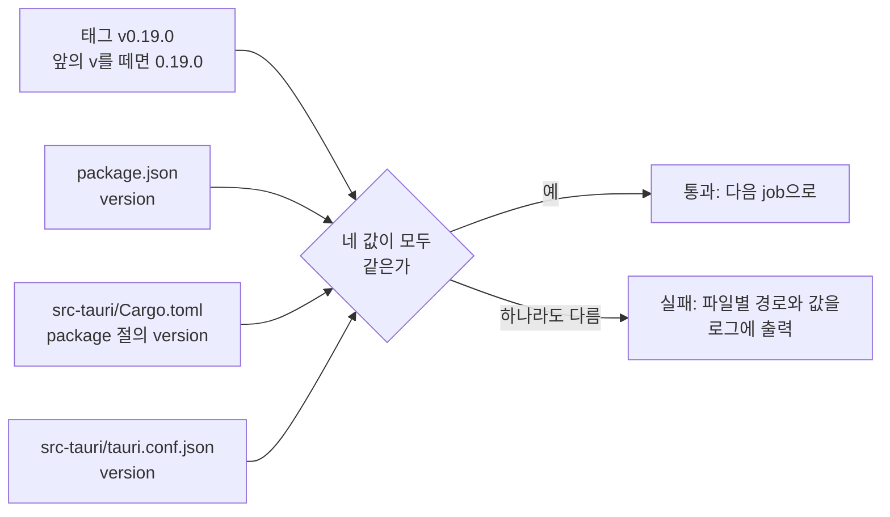

`Cargo.toml`에서는 `[package]` 절 안의 `version`만 읽습니다. `[dependencies]` 절의 `tauri = { version = "2" }` 같은 값을 앱 버전으로 착각하지 않게 하려는 것입니다. 태그 형식도 정규식 `^v(\d+)\.(\d+)\.(\d+)$`로 엄격히 봅니다. 점을 이스케이프하지 않으면 `v0x19x0` 같은 태그도 통과해 버리기 때문입니다. 지금 세 파일은 모두 `0.19.0`입니다.

커밋으로 보면 검사 스크립트는 `0d82ae4`, 워크플로·안내 블록·서명 설정은 `47833ee`, 문서는 `0cf857e`에서 들어왔습니다.

### 검증은 어떻게 했나

- **수용 기준**(AC, 완료를 판정하는 체크 항목)은 16개입니다. 그중 12개(AC-001~012)는 명령으로 자동 판정하고, 4개(AC-013~016)는 실제 태그 푸시와 실기기 실행이 필요해 병합 뒤 주인이 직접 확인합니다.
- **단위 테스트**: 검사 스크립트 테스트 24개가 통과합니다. 저장소 전체 테스트는 문서 정리 단계에서 109개 파일, 1789개가 통과했습니다.
- **워크플로 문법**: `actionlint .github/workflows/release.yml`이 아무 경고 없이 종료 코드 0으로 끝납니다.
- **독립 감사**: 작업한 쪽과 다른 검토자가 다섯 번 살펴봤습니다.
  - 계획 감사 1차는 불합격(0.75점)이었습니다. 맥 서명 여부, 첫 자동 릴리스 버전, main 포함 여부 검사를 정해야 했고, 초안 보장을 생성 호출로 옮기는 등 설계 결함이 나왔습니다. 주인은 이 결과를 보고 맥 ad-hoc 서명을 넣고, 첫 자동 릴리스를 v0.19.0으로 하고, main 포함 여부는 워크플로 대신 절차로 지키기로 정했습니다.
  - 계획 감사 2차와 구현 전 감사는 모두 조건부 합격(0.90점)이었고, 검사 명령의 판정 규칙 같은 문서상 부채를 남겼습니다.
  - 구현 뒤 감사는 조건부 합격(0.85점)이었습니다. 치명적 결함은 없었고, 주석 안에만 남은 `draft=true`로도 검사가 통과하던 허점, 빌드 중인 코드가 토큰을 볼 수 있다는 점(R-10), 워크플로 파일 규칙(R-11), 실제 첫 실행 화면 문구가 미확인이라는 점 등을 짚었습니다. 반영할 것은 반영하고, 나머지는 위험이나 후속 과제로 기록했습니다.
  - CI 보안 검토는 치명적·높음 등급 결함이 없다고 봤고, 중간 등급 하나는 수용했습니다. 8절의 태그 보호 규칙은 이 검토가 권고한 사항입니다.

### 기록해 둔 위험

| ID | 내용 | 대응 |
|---|---|---|
| R-8 | 빌드가 도는 도중에 주인이 Publish를 누르면, 게시된 릴리스에 파일이 올라갈 수 있습니다. 초안 확인은 빌드 시작 전에 한 번만 하기 때문입니다. | 막지 못합니다. "실행이 완전히 끝난 뒤에만 게시"를 규칙으로 지킵니다. 주인이 이 위험을 수용했습니다. |
| R-10 | 빌드 단계에는 쓰기 토큰이 있어야 업로드를 할 수 있습니다. 그런데 같은 단계에서 프런트엔드 빌드와 Rust 빌드 스크립트가 돌기 때문에, 오염된 의존성이 있다면 토큰을 읽을 수 있습니다. | 수용한 위험입니다. 토큰은 이 저장소에만 쓸 수 있고 job이 끝나면 만료됩니다. 근본적인 보강(토큰 없이 빌드하고 업로드만 따로 하기)은 별도 작업 후보입니다. |
| R-11 | GitHub 문서에 따르면, 태그가 가리키는 커밋이 기본 브랜치와 비교해 `.github/workflows/` 아래 파일을 추가하거나 바꾼 커밋이면 기본 토큰으로는 릴리스를 만들 수 없습니다(404 또는 403). | 태그는 PR이 병합된 뒤 원격 main의 최신 커밋에만 답니다. 리허설 태그도 마찬가지입니다. |

## 4. 한 번의 릴리스가 진행되는 모습

아래 그림은 `v0.19.0` 태그 하나가 올라갔을 때 누가 누구에게 무엇을 넘기는지 시간 순서대로 보여 줍니다. 위에서 아래로 읽으면 됩니다. `alt` 상자는 버전이 다를 때와 같을 때로 갈리는 지점입니다.

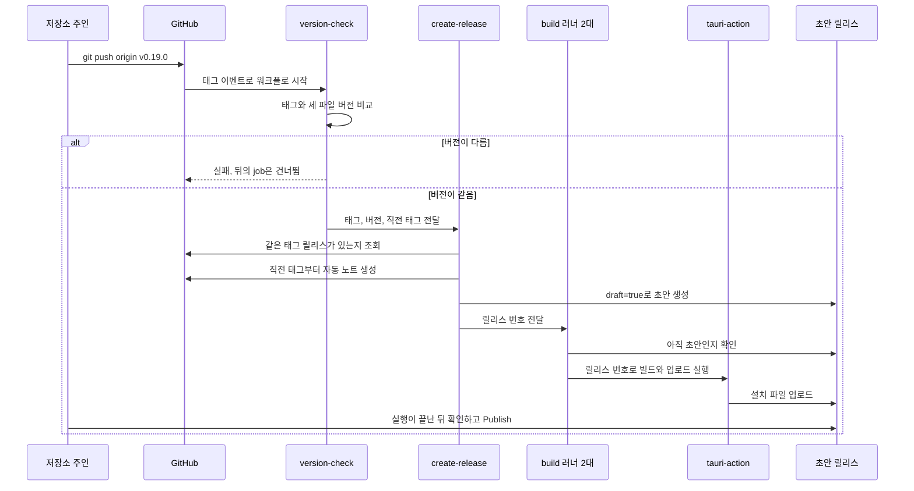

같은 내용을 말로 풀면 이렇습니다.

1. 주인이 `git push origin v0.19.0`으로 태그를 올립니다.
2. GitHub이 태그 이름이 `v숫자.숫자.숫자` 꼴인 것을 보고 `release.yml`을 시작합니다. `v0.19.0-rc.1` 같은 태그로는 시작하지 않습니다.
3. 첫 job(`version-check`)이 리눅스 서버 한 대에서 검사 스크립트를 돌립니다. 태그에서 `v`를 뗀 `0.19.0`이 세 파일의 버전과 모두 같아야 통과합니다. 통과하면 태그, 버전, 직전 버전 태그(`v0.18.0`)를 다음 job에 넘깁니다.
4. 둘째 job(`create-release`)이 같은 태그의 릴리스가 이미 있는지 확인합니다. 태그로 조회하는 API는 게시본만 돌려주므로 초안까지 찾으려고 릴리스 목록 전체를 살펴봅니다. 없으면 자동 노트를 만들고, 설치 안내 머리말을 맨 앞에 붙여 본문을 조립한 뒤 `mdedit v0.19.0`이라는 이름의 초안을 만듭니다.
5. 셋째 job(`build`)은 맥과 윈도 서버에서 동시에 시작합니다. 각자 의존성을 설치하고, 대상이 아직 초안인지 확인한 뒤, Tauri 빌드 액션(`tauri-action`)으로 설치 파일을 만들어 그 초안에 올립니다.
6. 모든 job이 끝나면 주인이 Releases 페이지에서 초안을 확인하고 직접 게시합니다.

## 5. 릴리스의 상태 변화

먼저 낱말 네 개를 구분해 두면 이해가 쉽습니다.

- **태그**: git 저장소 안의 이름표입니다. 특정 커밋에 `v0.19.0`이라는 이름을 붙일 뿐이고, 태그만으로는 설치 파일이 생기지는 않습니다.
- **릴리스**: GitHub 웹 페이지에 있는 "배포 게시물"입니다. 태그 하나에 연결되고, 설명(본문)과 첨부 파일(asset)을 가집니다.
- **초안**(draft): 아직 공개되지 않은 릴리스입니다. 저장소에 쓰기 권한이 있는 사람만 볼 수 있습니다.
- **게시**(published): 누구나 볼 수 있게 공개된 릴리스입니다. 초안에서 Publish를 누르면 이 상태가 됩니다.

아래 그림은 하나의 버전이 거치는 상태와, 실패하거나 다시 해야 할 때 돌아가는 길을 보여 줍니다.

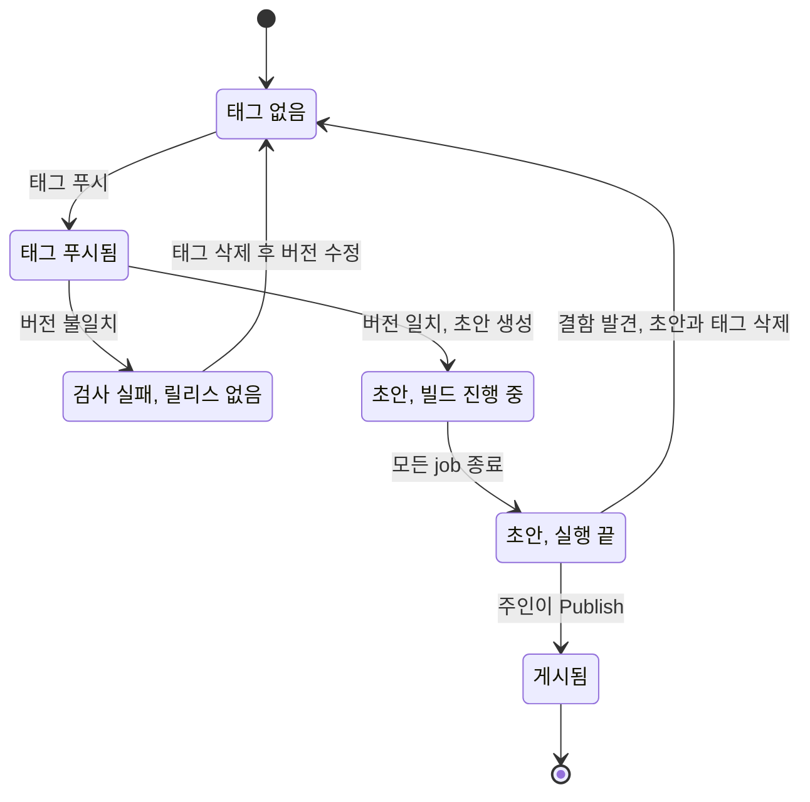

그림에서 눈여겨볼 점은 "초안, 빌드 진행 중"에서 "게시됨"으로 가는 화살표가 없다는 것입니다. 그 길은 막혀 있지 않지만(R-8), 규칙으로 쓰지 않기로 했습니다. 또 "게시됨"에서 돌아가는 화살표도 없습니다. 게시한 뒤에는 실패한 job을 다시 실행하지 않습니다.

## 6. 안전장치 지도

그림 3은 일어날 수 있는 사고와 그 사고를 막는 장치를 짝지어 보여 줍니다. 아래쪽 점선 세 줄은 워크플로가 막지 못해 사람의 절차로 대신하거나 위험으로 받아들인 경우입니다.

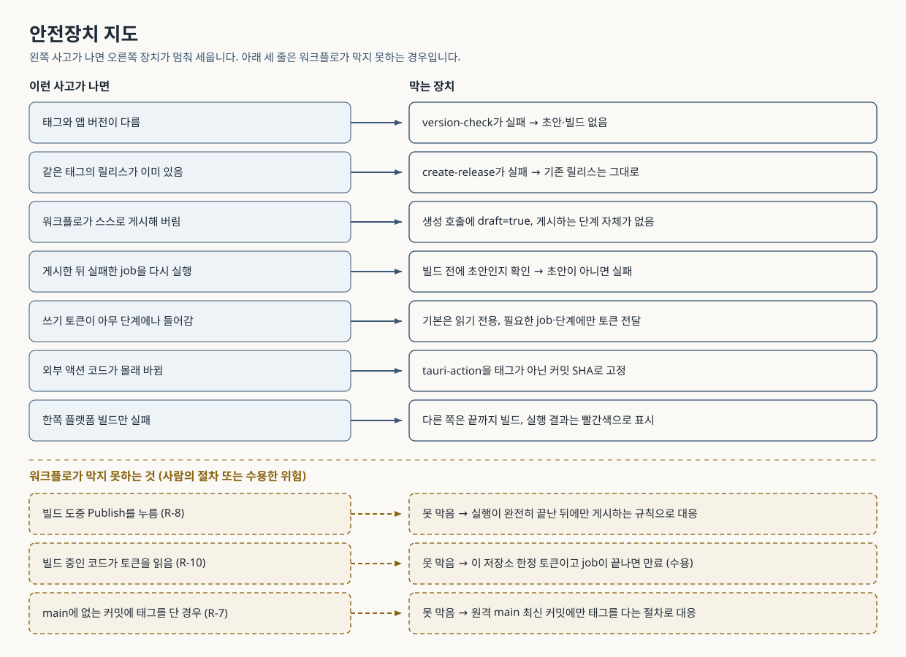

*그림 3. 안전장치 지도. 위 일곱 줄은 워크플로가 실제로 멈춰 세우고, 아래 세 줄은 사람의 규칙에 맡깁니다.*

| 이런 사고가 나면 | 막는 장치 | 못 막는 것 |
|---|---|---|
| 태그와 앱 버전이 다름 | `version-check`가 파일별 값을 남기고 실패, 뒤 job은 실행되지 않음 | 없음 |
| 같은 태그의 릴리스가 이미 있음(초안 포함) | `create-release`가 기존 릴리스 종류와 주소를 남기고 실패 | 없음 |
| 워크플로가 스스로 게시함 | 생성 호출에 `draft=true`, 게시 단계가 없음. 파일 머리 주석으로 "이 값을 지우지 말 것"을 남김 | 누군가 나중에 이 파일을 고치는 것은 리뷰로만 막을 수 있음 |
| 게시한 뒤 실패한 job을 다시 실행함 | 빌드 시작 전에 초안인지 확인하고 아니면 실패 | 확인 뒤 빌드 도중에 게시하는 경우(R-8) |
| 쓰기 토큰이 엉뚱한 단계로 감 | 기본 읽기 전용, 쓰기는 두 job에만, 토큰은 필요한 단계에만 | 빌드 단계 안의 코드가 토큰을 읽는 경우(R-10) |
| 외부 액션 코드가 바뀜 | 커밋 SHA로 고정 | 고정한 커밋 이후의 버그 수정도 자동으로 들어오지 않음 |
| 한쪽 플랫폼만 빌드 실패 | 다른 쪽은 끝까지 진행(`fail-fast: false`), 실행은 빨간색 | 파일이 빠진 초안을 사람이 게시하는 것 |
| main에 없는 커밋에 태그를 담 | 없음 | 워크플로가 검사하지 않음(R-7). 원격 main 최신 커밋에만 태그를 다는 절차로 지킴 |
| 워크플로 파일이 바뀐 커밋에 태그를 담 | 없음 | GitHub이 릴리스 생성을 거부할 수 있음(R-11). 병합 뒤에만 태그를 다는 절차로 지킴 |

## 7. 사용자 화면에서 벌어지는 일

이 앱은 Apple 공증(Apple이 앱을 검사하고 보증하는 절차)이나 Windows 코드 서명(인증 기관이 발급한 인증서로 서명하는 것)을 받지 않았습니다. 비용과 계정이 필요한 일이라 이번 범위에서 빼기로 주인이 정했습니다. 그 대신 사용자가 처음 실행할 때 운영체제가 경고를 한 번 띄웁니다. 그림 4는 README에 적은 대처 순서를 도식으로 옮긴 것입니다.

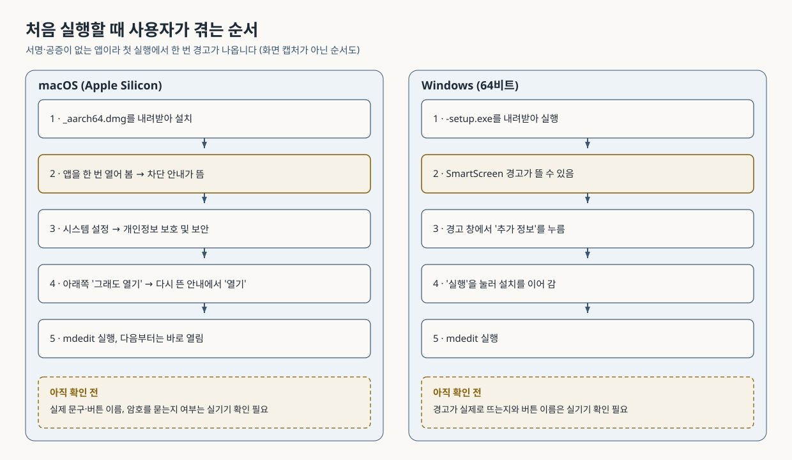

*그림 4. 첫 실행 순서. 실제 화면을 찍은 것이 아니라 README 안내를 순서대로 그린 도식입니다.*

- **macOS**: 앱을 한 번 열면 차단 안내가 뜹니다. 시스템 설정 → 개인정보 보호 및 보안으로 가서 아래쪽의 "그래도 열기"를 누르고, 다시 뜨는 안내에서 "열기"를 누릅니다. 다음부터는 바로 열립니다. 이 문구는 Apple 공식 안내를 따랐습니다.
- **Windows**: Microsoft Defender SmartScreen(윈도가 낯선 프로그램을 경고하는 기능)이 뜰 수 있습니다. "추가 정보"를 누른 뒤 "실행"을 선택합니다.

**버튼 이름과 화면 문구는 아직 실제 기기에서 확인하지 않았습니다.** 최신 macOS는 이 과정에서 암호를 물을 수도 있다는 지적이 있었습니다. 실기기 확인(수용 기준 AC-015·016) 뒤 화면과 다르면 README를 고칩니다. 내려받은 파일을 터미널 명령으로 우회하는 방법(`xattr`)은 비공식 방법이라 일부러 안내하지 않았습니다.

## 8. GitHub 화면에서 할 일과 코드로 이미 된 것

### 코드로 이미 된 것

트리거, 권한, 실행 순서, 초안 생성, 빌드, 업로드는 모두 `release.yml`에 들어 있습니다. 새 시크릿(비밀 값)은 필요 없고 GitHub이 자동으로 주는 `GITHUB_TOKEN`만 씁니다. 이 저장소에서는 이미 `Frontend Quality Gates` 워크플로가 PR과 main 푸시마다 돌고 있으므로 Actions 기능 자체는 켜져 있습니다.

### 주인이 GitHub 화면에서 직접 하는 일

| 하는 일 | 화면 위치 |
|---|---|
| 실행 지켜보기 | 저장소 위쪽의 **Actions** 탭 → 왼쪽 목록의 `Release` 워크플로 → 해당 태그의 실행 |
| 초안 확인 | 저장소 오른쪽의 **Releases** 또는 `https://github.com/bjw202/mdedit/releases` → `mdedit v0.19.0` 초안 → 첨부 파일과 본문 |
| 게시 | 초안의 편집 화면에서 **Publish release** |

명령줄을 선호하면 아래처럼 읽기 전용으로 상태를 볼 수도 있습니다(수용 기준 AC-014에 적힌 명령입니다).

```bash
gh run list --workflow release.yml --limit 1 --json conclusion --jq '.[0].conclusion'
gh release view v0.19.0 --json isDraft,name,assets
```

### 확인해 볼 곳 (필수 아님, 아직 확인 전)

- **저장소의 워크플로 권한 설정**(Settings → Actions → General → Workflow permissions): 워크플로가 job 단위로 쓰기 권한을 요청하도록 짰지만 저장소나 조직 설정이 이를 제한하고 있으면 초안 생성이 권한 오류로 실패할 수 있습니다. 첫 실행에서 `create-release`가 403으로 실패하면 이곳을 먼저 확인합니다. 이 저장소의 현재 설정 값은 확인하지 않았습니다.
- **태그 보호 규칙**(Settings → Rules → Rulesets에서 `v*` 태그 대상): CI 보안 검토가 권고 사항으로 제안했습니다. 누가 `v`로 시작하는 태그를 만들거나 지울 수 있는지 제한해, 실수로 올린 태그가 릴리스를 시작하는 일을 줄입니다. 선택 사항이며, 이 저장소에 맞는 설정인지는 확인하지 않았습니다. 켜면 9절의 리허설 태그 삭제나 10절의 태그 삭제도 규칙의 영향을 받을 수 있으니, 리허설을 마친 뒤 검토하는 편이 안전합니다.

## 9. 앞으로 할 일 (병합 뒤)

그림 5는 주인이 할 일을 순서대로 보여 줍니다. "외부 행동"이라고 표시한 단계는 결과가 저장소 밖으로 나가는 일이라, 주인이 직접 하거나 명시적으로 부탁한 경우에만 대신 실행합니다.

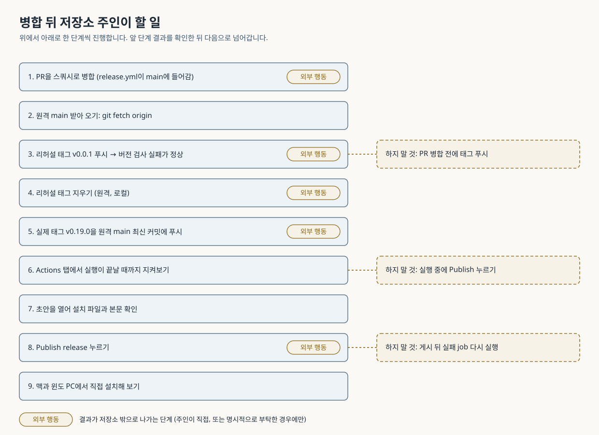

*그림 5. 병합 뒤 할 일. 오른쪽 점선 상자는 그 단계 근처에서 하지 말아야 할 일입니다.*

아래 그림은 같은 과정에서 각 확인 지점의 결과에 따라 어디로 가는지를 보여 줍니다.

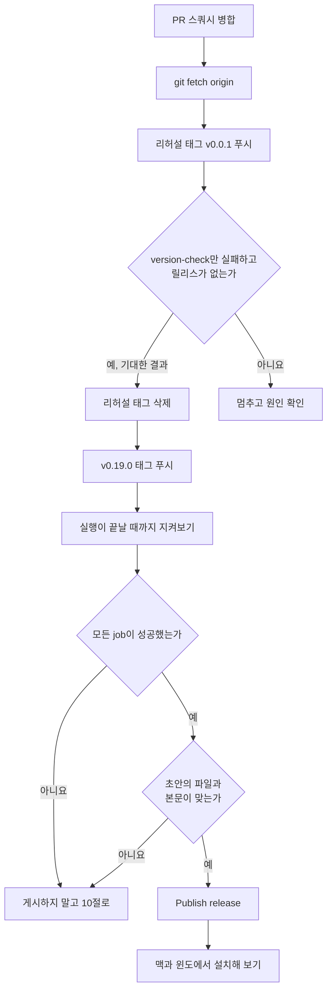

### 먼저 알아 둘 규칙 하나

**태그는 `release.yml`을 추가하는 PR이 main에 병합된 뒤에만 푸시합니다.** GitHub 문서에 따르면, 태그가 가리키는 커밋이 기본 브랜치와 비교해 `.github/workflows/` 아래 파일을 추가하거나 바꾼 커밋이면, 기본 `GITHUB_TOKEN`으로는 릴리스를 만들 수 없습니다(404 또는 403). 병합 전 브랜치의 커밋은 바로 이 경우에 해당합니다. 병합한 뒤 원격 main의 최신 커밋은 기본 브랜치 그 자체이므로 문제가 없습니다.

### 단계별 할 일

1. **PR을 스쿼시로 병합합니다.** (외부 행동) 이 브랜치의 커밋이 main에 한 커밋으로 합쳐져 들어갑니다.
2. **원격 main을 받아 옵니다.** 태그는 원격 main을 기준으로 달기 때문에 아래 명령이면 충분합니다.

   ```bash
   git fetch origin
   ```

3. **실패 경로 리허설: 버림용 태그 `v0.0.1`을 푸시합니다.** (외부 행동) 앱 버전은 0.19.0이므로 버전 검사가 실패해야 정상입니다. 명령은 수용 기준 AC-013에 적힌 그대로입니다.

   ```bash
   git tag v0.0.1 origin/main && git push origin v0.0.1
   ```

   기대 결과: Actions 탭에서 `version-check` job이 빨간색이고, 로그에 세 파일의 경로와 값(`"0.19.0"`)이 보이며, `create-release`와 `build`는 건너뜁니다. 릴리스는 만들어지지 않아야 합니다. 아래 명령이 "release not found"를 내면 맞습니다.

   ```bash
   gh release view v0.0.1
   ```

4. **리허설 태그를 지웁니다.** (외부 행동) 원격 태그와 로컬 태그를 모두 지웁니다.

   ```bash
   git push --delete origin v0.0.1 && git tag -d v0.0.1
   ```

5. **실제 태그 `v0.19.0`을 원격 main 최신 커밋에 답니다.** (외부 행동) BUILD.md의 명령 그대로입니다.

   ```bash
   git fetch origin && git tag v0.19.0 origin/main
   git push origin v0.19.0
   ```

6. **실행이 완전히 끝날 때까지 지켜봅니다.** Actions 탭에서 `version-check` → `create-release` → `build`(맥, 윈도 두 개)가 모두 끝나야 합니다. 이 사이에는 Publish를 누르지 않습니다(R-8).
7. **초안을 엽니다.** Releases 페이지의 `mdedit v0.19.0` 초안에서 다음을 확인합니다.
   - 이름이 `_aarch64.dmg`, `-setup.exe`, `.msi`로 끝나는 파일이 각각 있는지. 윈도 `.msi` 이름에는 언어 표시(예: `_en-US`)가 붙을 수 있다는 소스 분석이 있었지만 아직 확인 전입니다. 이 셋 말고 다른 파일이 더 붙는지도 확인 전입니다.
   - 본문이 "설치 파일" 안내 표로 시작하고, 그 뒤 자동 노트에 `v0.18.0...v0.19.0` 비교 링크가 있는지.
8. **확인이 끝나면 Publish release를 누릅니다.** (외부 행동) 이때부터 누구나 내려받을 수 있습니다.
9. **실제 컴퓨터에서 설치해 봅니다.** Apple Silicon 맥과 64비트 윈도 PC에서 README 안내대로 설치하고, 화면 문구가 README와 같은지 봅니다. 맥에서는 아래 두 명령으로 ad-hoc 서명을 확인할 수 있습니다(수용 기준 AC-015). 각각 `Signature=adhoc`과 `0`이 나오면 맞습니다.

   ```bash
   codesign -dv --verbose=2 /Applications/mdedit.app 2>&1 | grep -E "^Signature="
   codesign --verify --deep --strict /Applications/mdedit.app; echo $?
   ```

### 하지 말 것

- PR 병합 전에 태그를 푸시하지 않습니다(R-11).
- 실행 도중에 Publish를 누르지 않습니다(R-8).
- 게시한 뒤에 실패한 job을 다시 실행하지 않습니다.
- main에 없는 커밋에 태그를 달지 않습니다(R-7).

## 10. 문제가 생겼을 때

아래 그림은 문제가 어디서 보이는지에 따라 첫 확인 지점을 고르는 순서입니다. 마름모는 질문, 네모는 할 일입니다.

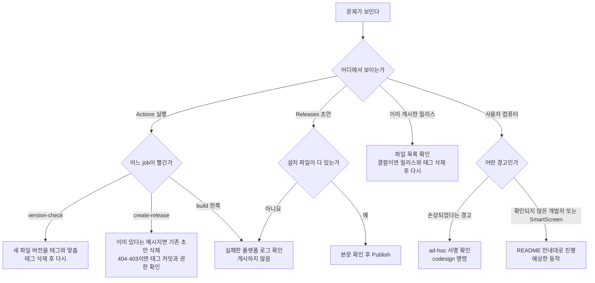

| 증상 | 먼저 볼 것 | 고치는 순서 |
|---|---|---|
| `version-check` 실패. 로그에 `버전 불일치: package.json의 version은 "0.18.0"인데 태그는 v0.19.0(기대값 0.19.0)이다.` 같은 줄이 있음 | 로그에 찍힌 세 파일의 값 | 세 파일 버전을 맞춰 main에 병합 → 태그 삭제(원격, 로컬) → 병합된 main 최신 커밋에 다시 태그 |
| `version-check` 실패. `태그 형식 위반`이 보임 | 태그 이름이 정확히 `v숫자.숫자.숫자`인지 | 잘못 단 태그를 지우고 올바른 이름으로 다시 |
| `create-release` 실패. `태그의 릴리스가 이미 있다`가 보임 | 메시지에 찍힌 기존 릴리스가 초안인지 게시본인지 | 초안이면 아래 정리 순서로 지우고 다시 태그. 게시본이면 워크플로는 건드리지 않으므로 정말 다시 낼지부터 판단 |
| `create-release`가 404 또는 403으로 실패 | 태그가 원격 main 최신 커밋에 있는지(R-11), 저장소 워크플로 권한 설정(8절) | 태그를 지우고 원격 main 최신 커밋에 다시 |
| 초안에 파일이 빠짐 | Actions에서 빨간 `build` job의 로그 | 게시하지 않음 → 원인 수정을 main에 병합 → 아래 정리 순서 → 다시 태그 |
| 한 플랫폼 빌드만 실패 | 실패한 플랫폼의 로그(다른 쪽 파일은 이미 올라가 있음) | 위와 같음 |
| 빌드 도중에 실수로 게시함 | 게시된 릴리스의 파일 목록이 완전한지 | 실행이 끝날 때까지 기다린 뒤 파일을 확인. 결함이 있으면 아래 정리 순서 |
| 맥에서 "손상되었다"고 막힘 | 9절의 `codesign` 명령으로 `Signature=adhoc`인지 | ad-hoc 서명이 기대대로 들어가지 않은 경우로, 설정과 빌드 로그를 조사해야 합니다. 아직 실제로 겪어 본 경우가 아닙니다 |

### 정리 순서 (BUILD.md 기준)

초안이나 빌드에 결함이 있으면 아래 순서로 지운 뒤 고쳐서 다시 태그를 답니다. 세 명령 모두 외부에 영향을 주는 행동입니다. 첫 줄은 릴리스(초안 포함)를, 둘째 줄은 원격 태그를, 셋째 줄은 내 컴퓨터의 태그를 지웁니다.

```bash
gh release delete v0.19.0 --yes
git push --delete origin v0.19.0
git tag -d v0.19.0
```

순서가 중요합니다. 릴리스를 남긴 채 태그를 다시 올리면 `create-release`가 "이미 있다"며 실패합니다.

## 11. 용어 풀이

| 용어 | 뜻 |
|---|---|
| GitHub Actions | GitHub 서버에서 정해 둔 작업을 자동으로 돌려 주는 서비스입니다. 빌려 쓰는 공용 작업장에 비유할 수 있습니다. |
| 워크플로(workflow) | Actions가 따르는 대본 파일입니다. 이 저장소에서는 `.github/workflows/release.yml`입니다. |
| job | 워크플로 안의 작업 묶음입니다. job마다 서버 한 대를 따로 받습니다. 이번 워크플로에는 `version-check`, `create-release`, `build` 세 개가 있습니다. |
| 러너(runner) | job을 실제로 실행하는 서버입니다. 이번에는 리눅스, 맥(`macos-latest`), 윈도(`windows-latest`) 러너를 씁니다. |
| 행렬(matrix) | 같은 job을 조건만 바꿔 여러 번 돌리는 방법입니다. `build` job은 맥과 윈도 두 조건으로 따로 돕니다. |
| 태그(tag) | 특정 커밋에 붙이는 이름표입니다. 책의 판 번호처럼 "이 커밋이 0.19.0판"이라고 표시합니다. |
| 릴리스(release) | GitHub 웹에 올리는 배포 게시물입니다. 태그 하나에 연결되고 설명과 첨부 파일을 가집니다. |
| 초안(draft) | 공개 전의 릴리스입니다. 인쇄 전 교정쇄처럼 내부에서만 보고 고칩니다. |
| 자산(asset) | 릴리스에 붙은 첨부 파일입니다. 이번에는 `.dmg`, `.exe`, `.msi`입니다. |
| `GITHUB_TOKEN` | 실행마다 GitHub이 새로 발급하는 출입증입니다. 이 저장소에만 쓸 수 있고 job이 끝나면 만료됩니다. |
| 권한(permissions) | 출입증으로 할 수 있는 일의 범위입니다. 읽기만 할지, 쓰기도 할지를 job별로 정합니다. |
| 서명과 공증 | 서명은 "누가 만들었는지" 도장을 찍는 것이고, 공증(notarization)은 Apple이 앱을 검사한 뒤 보증해 주는 절차입니다. 둘 다 계정과 비용이 필요해 이번에는 하지 않았습니다. |
| ad-hoc 서명 | 인증서 없이 찍는 임시 도장입니다. 누가 만들었는지는 보증하지 못하지만 파일이 중간에 바뀌지 않았다는 것은 보여 줍니다. 맥이 "손상됨"으로 막는 일을 피하려고 넣었습니다. |
| Gatekeeper / SmartScreen | 맥과 윈도가 낯선 앱을 처음 실행할 때 확인하는 문지기 기능입니다. 서명·공증이 없으면 경고를 띄웁니다. |
| 스쿼시 병합(squash merge) | PR의 여러 커밋을 하나로 합쳐 main에 넣는 병합 방식입니다. |
| SHA 고정 | 외부 액션을 이름(태그) 대신 커밋 해시로 지정하는 것입니다. 태그는 나중에 다른 코드를 가리키도록 바뀔 수 있지만 커밋 해시는 바뀌지 않습니다. 책을 "최신판" 대신 ISBN으로 지정하는 것과 비슷합니다. |

## 12. 아직 확인하지 못한 것

- **실제 워크플로 실행**: 이 워크플로는 아직 GitHub 서버에서 한 번도 돌지 않았습니다. 위의 동작 설명은 모두 파일 내용, 로컬 검사, 독립 감사, GitHub 공식 문서에 근거합니다.
- **맥 ad-hoc 서명 결과**: 빌드된 앱이 실제로 `Signature=adhoc`을 갖는지, 브라우저로 받은 앱이 "손상됨" 없이 "그래도 열기" 경로로 열리는지 확인 전입니다. 로컬 `npm run build`가 같은 서명을 받는다는 설명도 실제 빌드로 확인하지 않았습니다.
- **윈도 화면 문구**: SmartScreen 경고가 실제로 뜨는지, 버튼 이름이 "추가 정보"·"실행"인지 확인 전입니다.
- **빌드 전 초안 확인 호출**: 빌드 job이 쓰는 "릴리스 번호로 조회" API가 워크플로 토큰으로 초안을 돌려주는지는 확인 전입니다. 독립 감사 뒤 권한 있는 사용자로 기존 초안(v0.13.2)을 조회해 본 기록은 있지만 워크플로 토큰으로 한 것은 아닙니다. 만약 초안을 돌려주지 않으면 빌드가 업로드 전에 실패합니다(안전한 쪽으로 실패).
- **최종 파일 목록**: 초안에 붙는 파일의 정확한 이름과 개수(윈도 `.msi`의 언어 표시, 맥 쪽 추가 파일 여부)는 확인 전입니다.
- **Rust 테스트**: `cargo test`는 지금 어떤 CI에서도 돌지 않습니다. 기존 `frontend-gates.yml`은 lint·타입 검사·vitest·Playwright만 돌리고, 릴리스 워크플로도 Rust 테스트를 돌리지 않습니다.
- **저장소 설정 값**: 8절의 워크플로 권한 설정과 태그 보호 규칙은 이 저장소의 현재 값을 확인하지 않았습니다.

## 13. 더 읽을 곳

- 배포 절차의 기준 문서: [docs/BUILD.md — GitHub Releases로 배포하기](BUILD.md#github-releases로-배포하기)
- 사용자용 내려받기 안내: [README.md — 설치 파일 내려받기](../README.md#설치-파일-내려받기)
- 요구사항과 위험 표: [.moai/specs/SPEC-INFRA-002-release-automation/spec.md](../.moai/specs/SPEC-INFRA-002-release-automation/spec.md)
- 수용 기준 16개와 판정 명령: [acceptance.md](../.moai/specs/SPEC-INFRA-002-release-automation/acceptance.md)
- 주인이 내린 결정 기록: [interview.md](../.moai/specs/SPEC-INFRA-002-release-automation/interview.md)
- 외부 근거 조사: [research.md](../.moai/specs/SPEC-INFRA-002-release-automation/research.md)
- 감사 보고서
  - 계획 감사 1차: [.moai/reports/plan-audit/SPEC-INFRA-002-iter1.md](../.moai/reports/plan-audit/SPEC-INFRA-002-iter1.md)
  - 계획 감사 2차: [.moai/reports/plan-audit/SPEC-INFRA-002-iter2.md](../.moai/reports/plan-audit/SPEC-INFRA-002-iter2.md)
  - 구현 전 감사: [.moai/reports/plan-audit/SPEC-INFRA-002-review-1.md](../.moai/reports/plan-audit/SPEC-INFRA-002-review-1.md)
  - 구현 뒤 감사: [.moai/reports/sync-audit/SPEC-INFRA-002-sync-audit.md](../.moai/reports/sync-audit/SPEC-INFRA-002-sync-audit.md)
  - 문서 정리 보고서: [.moai/reports/sync-report-20261029T055301Z.md](../.moai/reports/sync-report-20261029T055301Z.md)
