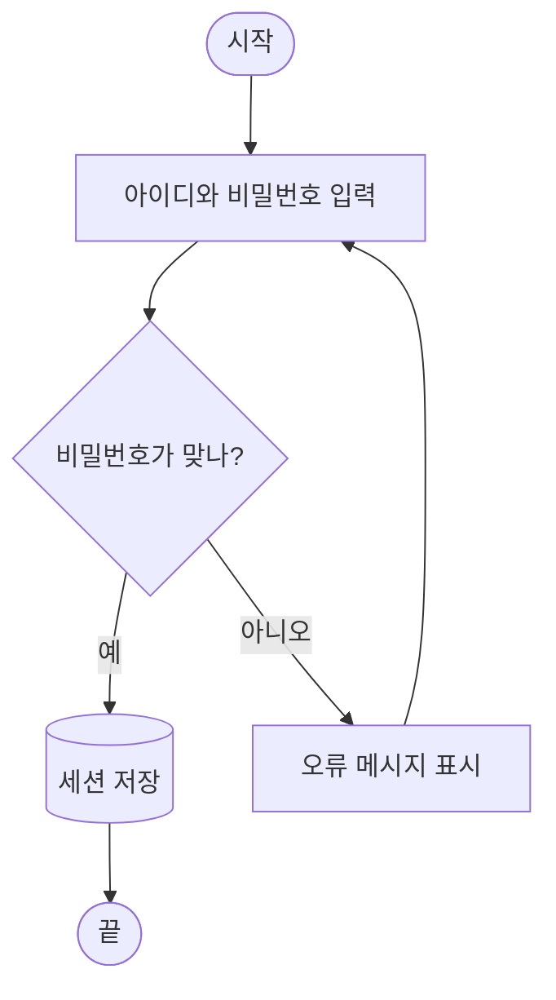
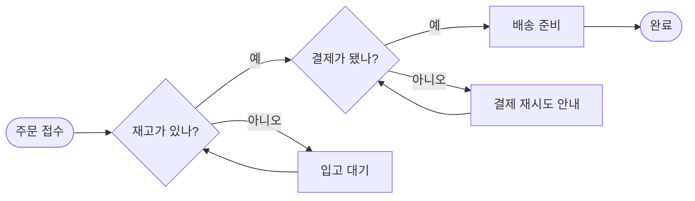
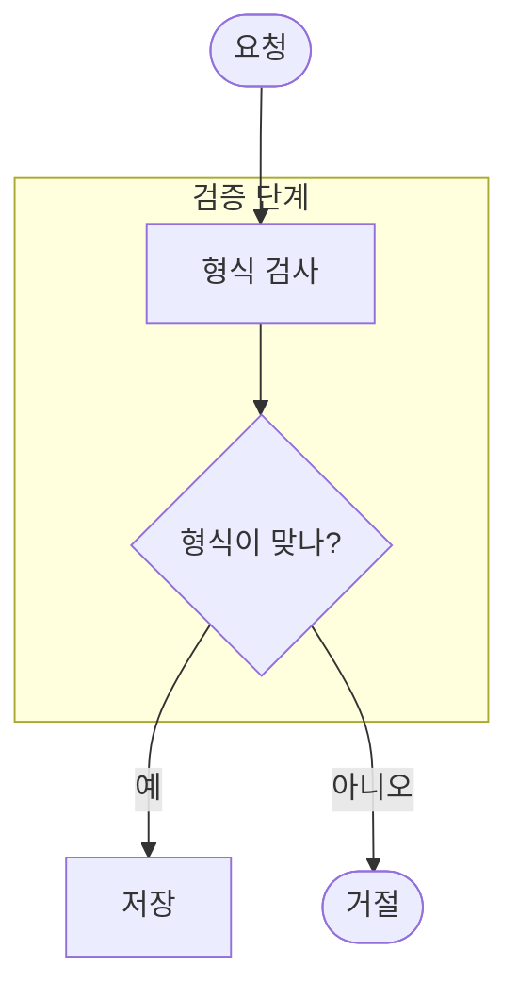
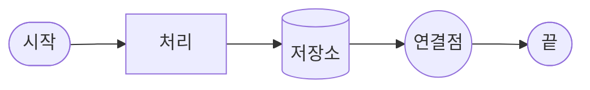
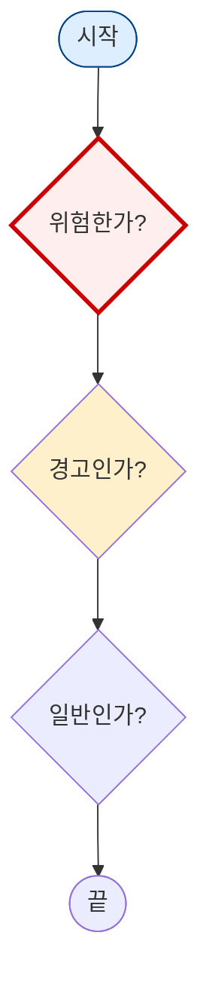
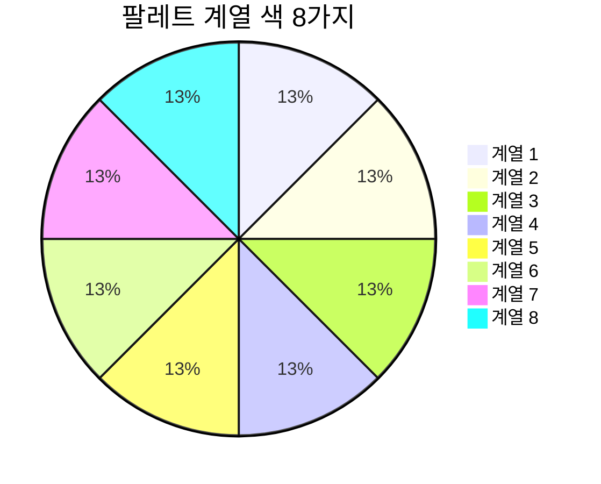
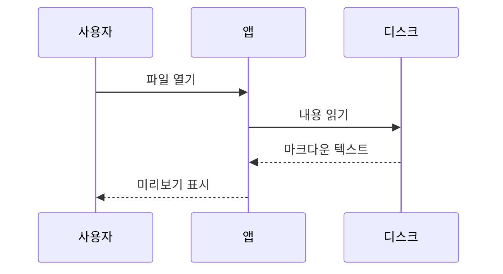

# 다이어그램 팔레트 샘플 (v0.19.0, SPEC-PREVIEW-017)

이 문서는 MdEdit 0.19.0의 다이어그램 "모양 기반 자동 톤"을 눈으로 확인하는 샘플입니다.
Split/Preview 모드로 열고, **라이트와 다크 테마를 모두** 바꿔 가며 각 항목이 기대대로 보이는지 확인하세요.
내보내기(HTML·PDF·DOCX)도 같은 색으로 나와야 합니다.

---

## 이번 버전이 하는 일

다이어그램은 "잉크 앤 허니" 고정 팔레트로 그려집니다(0.18.0부터). 0.19.0은 여기에 **노드 모양에 따른 톤** 두 가지를 더했습니다. 모양이 이미 역할을 말해 주므로, 색은 그 역할을 한 번 더 또렷하게 해 줍니다.

| 역할 | mermaid 문법 | 채움 | 테두리 |
| --- | --- | --- | --- |
| 판단 | `B{질문?}` | `#F7F2E7` 연한 크림 | `#8A6410` 진한 꿀색 (새 토큰 `--pele-decision-border`) |
| 시작·끝 | `A([시작])` | `#EEF3F7` 기본 | `#3A5673` 잉크 블루, 1.5px |
| 처리·저장소·원 | `C[처리]` `D[(저장소)]` `E((원))` | `#EEF3F7` 기본 | `#97A4B1` 기본 |
| 서브그래프 묶음 | `subgraph` | 반투명 크림 | 기본 |

톤은 모양으로만 정해집니다. 라벨 문구나 노드 순서, 앱 테마는 보지 않습니다.

---

## 1. 기본 흐름: 로그인

시작·끝은 잉크 블루 테두리, 판단은 꿀색 테두리, 나머지는 기본 색으로 보여야 합니다.
간선 라벨("예"·"아니오") 주위에 **밝은 띠(이음매)가 없어야** 합니다. 라이트 테마에서 특히 확인하세요.

---

## 2. 판단이 여러 번 나오는 흐름: 주문 처리

판단 노드가 둘이어도 둘 다 같은 꿀색 테두리여야 합니다. 라벨이 달라도 톤은 같습니다.

---

## 3. 서브그래프 안의 판단 노드

묶음(서브그래프) 바탕은 반투명 크림이라 판단 노드의 채움과 비슷합니다. 이 경우 **테두리 색**으로 구분됩니다.
묶음 자체의 색은 바뀌지 않습니다.

---

## 4. 다른 모양은 그대로

사각형·원통·원은 기본 색을 유지합니다. 원(`((...))`)은 연결점이나 강조에도 쓰여서 일부러 시작·끝으로 취급하지 않습니다.

---

## 5. 작성자 스타일이 항상 우선

`classDef`·`class`·`style`로 직접 지정한 속성은 그대로 이깁니다. 지정하지 않은 속성만 모양 톤을 받습니다.

- 시작 노드 `A`: `style`로 채움과 테두리를 모두 지정 → 지정한 연한 파랑과 진한 파랑 그대로
- 판단 노드 `B`: `classDef hot`으로 채움·테두리·두께 지정 → 붉은 계열, 3px 그대로
- 판단 노드 `C`: `classDef warm`으로 **채움만** 지정 → 채움은 노랑, 테두리는 꿀색 판단 톤
- 판단 노드 `D`: 지정 없음 → 기본 판단 톤

---

## 6. 같은 팔레트는 다른 다이어그램에도

고정 팔레트의 계열 색(series 1~8)이 파이 차트에서 순서대로 보입니다. 라이트·다크에서 같은 색이어야 합니다.

시퀀스 다이어그램도 같은 팔레트로 그려집니다. (모양 기반 톤은 플로차트의 판단·시작/끝 노드에만 적용됩니다.)

---

## 확인 체크리스트

- [ ] 1~3번: 판단 노드의 테두리가 꿀색, 시작·끝 노드의 테두리가 잉크 블루로 구분된다
- [ ] 1번·2번: 라이트 테마에서 "예"·"아니오" 라벨 주위에 밝은 띠가 없다
- [ ] 라이트 ↔ 다크 전환: 노드 색은 그대로이고 다이어그램이 다시 그려지며 깜빡이지 않는다 (다크에서는 다이어그램이 종이 카드처럼 보인다)
- [ ] 4번: 사각형·원통·원은 기본 색이다
- [ ] 5번: 작성자가 지정한 색이 그대로이고, 채움만 지정한 판단 노드는 테두리가 꿀색이다
- [ ] 이 문서를 HTML·PDF·DOCX로 내보내도 같은 색이다

색 값과 토큰은 `src/styles/mdedit-tokens.css`, 미리보기 규칙은 `src/index.css`(`SPEC-PREVIEW-017 shape-tone` 블록), 내보내기 주입은 `src/lib/export/exportUtils.ts`에 있습니다.
